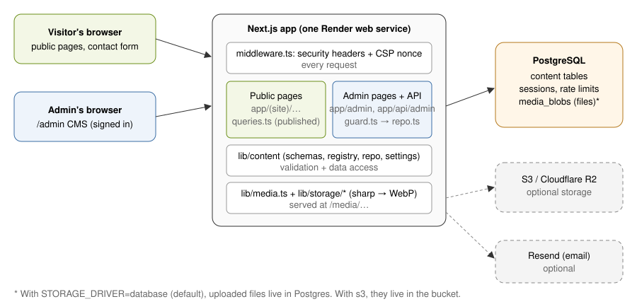

# How to use this handbook

This handbook documents the finished portfolio application in the `portfolio/` folder of the **Claude-start** repository. It is written so you can come back after weeks away and still change anything confidently.

- **Most changes need no code at all.** Use the admin portal at `/admin`. Section D says, for every common task, whether to use the admin or edit code (and which file).
- All paths are relative to `portfolio/` unless they start with the repository root.
- Section J is a one-page lookup table: "I want to change X → go here".
- No passwords, keys or secrets appear in this document.

# A. Project overview

## What the application does

It is two things in one deployable service:

1. **A public portfolio website** for Snigdh R.N.: a cinematic, animated, editorial site with Hero, About (two real photographs), Research, Projects (each with its own case-study page), Achievements, Experience & Education, Skills and Contact.
2. **A private content management system (CMS)** at `/admin`. Signing in lets you create, edit, publish, unpublish, reorder and delete every piece of content, upload photos and documents, change contact details, reorder or hide homepage sections, edit SEO and appearance, read contact-form messages and manage your password. Changes appear on the public site **immediately**, with no rebuild or redeploy.

## Technology stack

| Layer | Technology | Why |
|---|---|---|
| Framework | **Next.js 15** (App Router), **React 19**, **TypeScript** | Server-rendered pages (fast, indexable), API routes and the CMS in one app |
| Styling | **Tailwind CSS 3** + CSS variables (`src/app/globals.css`) | Design tokens, consistent spacing, easy theming |
| Animation | **Framer Motion 12** + one hand-written canvas (`HeroField.tsx`) | Scroll reveals, text reveals, parallax, transitions |
| Database | **PostgreSQL** via **Drizzle ORM** + `pg` | Persistent, typed queries, SQL migrations |
| Validation | **zod 4** | One schema per content type, used by the API (and seed) |
| Images | **sharp** | Converts uploads into responsive WebP sizes, strips metadata |
| Markdown | **react-markdown** + remark-gfm | Safe rich text (raw HTML is not rendered) |
| Fonts | Instrument Serif (display), Geist Sans (text), Geist Mono (labels) | Self-hosted; no external font requests |
| Hosting | **Render** web service + Render Postgres | `portfolio/render.yaml` Blueprint |

## How the pieces fit together

{.diagram}

**A public page request:** browser → `middleware.ts` (adds security headers) → `app/(site)/page.tsx` → `getSiteData()` in `lib/content/queries.ts` reads **published** rows from Postgres (once per request) → section components render HTML → client components add animation.

**An admin edit:** admin form (`EntityForm.tsx`) → `fetch` with the CSRF token → `app/api/admin/[entity]/[id]/route.ts` → `requireAdmin()` checks the session, Origin and CSRF token → `repo.ts` validates with zod and writes to Postgres → `revalidateContent()` clears Next's route caches → the next public request shows the change.

**An upload:** Media picker → `POST /api/admin/media` → `lib/media.ts` sniffs the file type, converts images to WebP at 480/960/1600/2400 px → `lib/storage` stores the bytes → a `media` row records the variants → pages reference it as `/media/img/<id>/w960.webp`.

## Public and private parts

| Public (anyone) | Private (signed-in admin only) |
|---|---|
| `/`, `/projects/<slug>`, `/research/<slug>` | `/admin` and everything below it |
| `/resume` (redirects to the CV PDF) | `/api/admin/*` (all content mutations) |
| `/media/*` (published images and PDFs) | Draft previews of project/research pages |
| `/api/contact` (POST, rate-limited) | Contact messages inbox |
| `/api/health`, `/sitemap.xml`, `/robots.txt`, `/opengraph-image` | |

# B. File and folder tree

Generated dependencies (`node_modules/`), build output (`.next/`), test screenshots and local env files are excluded.

```text
portfolio/
├── .env.example                 environment variable template (placeholders only)
├── .gitignore
├── .node-version                Node 22
├── README.md
├── render.yaml                  Render Blueprint (web service + Postgres)
├── package.json / package-lock.json
├── next.config.ts               Next.js settings
├── tailwind.config.ts           design tokens → Tailwind classes
├── postcss.config.mjs
├── tsconfig.json
├── eslint.config.mjs
├── drizzle.config.ts            drizzle-kit (migration generator) settings
├── vitest.config.ts             test runner settings
├── drizzle/
│   ├── 0000_init.sql            initial database schema (SQL)
│   └── meta/                    drizzle-kit snapshot + journal (do not edit)
├── scripts/
│   ├── prepare.ts               start-up: migrate → seed → admin bootstrap
│   ├── migrate.ts               npm run db:migrate
│   ├── seed.ts                  npm run db:seed
│   └── create-admin.ts          npm run admin:create
├── seed/
│   ├── content.ts               all initial content (from the CV, brief and repo)
│   └── assets/                  portraits, CV PDF, Sapthagiri screenshots
├── docs/
│   ├── HANDBOOK.md              this document (source)
│   ├── Snigdh_Personal_Website_Codebase_Handbook.pdf
│   ├── build-pdf.mjs            HANDBOOK.md → PDF
│   ├── DEPLOYMENT.md            Render guide
│   └── PROGRESS.md              decisions, open items, verification log
├── tests/
│   ├── setup.ts                 points tests at the test database
│   ├── server-only-stub.ts, next-cache-stub.ts
│   ├── unit/security.test.ts    hashing, URL/XSS validation, contact validation, origin check
│   ├── unit/content.test.ts     WhatsApp/mailto links, slugs, settings, SSL config
│   ├── integration/db.test.ts   migrations, seed, CRUD, media pipeline, rate limit, admin
│   └── e2e/run.mjs              33 browser/HTTP checks against a running server
└── src/
    ├── middleware.ts            security headers + CSP nonce
    ├── app/
    │   ├── layout.tsx           <html>, fonts, global metadata, accent colour
    │   ├── globals.css          design tokens, base styles, prose styles
    │   ├── fonts/               self-hosted Instrument Serif
    │   ├── icon.svg             favicon
    │   ├── not-found.tsx, error.tsx, global-error.tsx
    │   ├── sitemap.ts, robots.ts, opengraph-image.tsx
    │   ├── (site)/              PUBLIC SITE
    │   │   ├── layout.tsx       nav, footer, intro, cursor, WhatsApp button
    │   │   ├── page.tsx         homepage (section order from settings)
    │   │   ├── projects/[slug]/page.tsx
    │   │   └── research/[slug]/page.tsx
    │   ├── media/[...key]/route.ts   serves stored files
    │   ├── resume/route.ts          /resume → CV PDF
    │   ├── admin/               ADMIN CMS
    │   │   ├── layout.tsx       noindex metadata
    │   │   ├── login/page.tsx
    │   │   └── (panel)/         protected area
    │   │       ├── layout.tsx   session check → AdminShell
    │   │       ├── page.tsx     dashboard
    │   │       ├── [entity]/page.tsx       list (projects, research, …)
    │   │       ├── [entity]/[id]/page.tsx  editor ("new" = create)
    │   │       ├── settings/ media/ messages/ account/
    │   └── api/
    │       ├── health/route.ts
    │       ├── contact/route.ts
    │       └── admin/
    │           ├── auth/login, auth/logout
    │           ├── [entity]/route.ts, [entity]/[id]/route.ts, [entity]/reorder/route.ts
    │           ├── settings/route.ts
    │           ├── media/route.ts, media/[id]/route.ts
    │           ├── messages/[id]/route.ts
    │           └── account/password, account/sessions
    ├── components/
    │   ├── site/                public sections + chrome
    │   ├── admin/               CMS interface
    │   ├── motion/              Reveal, SplitWords, Counter, Parallax, Magnetic
    │   └── shared/              Markdown, MediaImage, ProjectVisual, Lightbox, icons
    └── lib/
        ├── api.ts, utils.ts, contact.ts, email.ts, site.ts, revalidate.ts
        ├── media.ts, media-url.ts, media-usage.ts
        ├── db/schema.ts, db/client.ts
        ├── auth/password.ts, session.ts, guard.ts, rate-limit.ts, request.ts
        ├── content/schemas.ts, settings.ts, settings-fields.ts, registry.ts, repo.ts, queries.ts
        ├── storage/index.ts, database.ts, s3.ts, local.ts, types.ts
        └── ops/migrate.ts, seed.ts, admin.ts
```

# C. File-by-file explanation

Legend for **"Edit when…"**: ✏️ you'd normally edit this for the change named · 🔒 rarely, only for deeper changes · ⛔ generated, don't edit by hand.

## C.1 Configuration and tooling

**`package.json`**: dependencies and npm scripts (`dev`, `build`, `start`, `db:*`, `admin:create`, `test`, `test:e2e`, `docs:pdf`). Note that `start` runs `db:prepare` before `next start`, so every boot migrates and seeds safely. ✏️ adding a dependency or script.

**`next.config.ts`**: Next settings: no `x-powered-by` header, `sharp` and `pg` kept out of the bundler, `outputFileTracingRoot` pinned to this folder (the repo contains other apps). 🔒

**`tailwind.config.ts`**: maps the CSS variables in `globals.css` to Tailwind colours (`bg`, `surface`, `fg`, `muted`, `dim`, `accent`…), font families (`font-display`, `font-sans`, `font-mono`), easing curves (`ease-expo`) and keyframes (marquee, scroll cue, blink). ✏️ new design tokens or animations.

**`tsconfig.json`**: strict TypeScript, `@/…` alias for `src/…`. 🔒

**`eslint.config.mjs`**: Next.js recommended lint rules. 🔒

**`drizzle.config.ts`**: tells `drizzle-kit generate` where the schema is (`src/lib/db/schema.ts`) and where to write migrations (`drizzle/`). 🔒

**`vitest.config.ts`**: test runner: aliases `server-only` and `next/cache` to stubs, loads `tests/setup.ts`, runs test files one at a time (they share a database). 🔒

**`.env.example`**: every environment variable with placeholder values and comments. Copy to `.env` for local development. ✏️ when adding a new variable.

**`render.yaml`**: Render Blueprint: web service (`rootDir: portfolio`, build/start commands, health check, env vars) plus a Postgres database. ✏️ region, plan, or new env vars.

**`drizzle/0000_init.sql`**: ⛔ generated SQL creating all tables, indexes, foreign keys and CHECK constraints. `drizzle/meta/*` ⛔ is drizzle-kit's bookkeeping.

## C.2 Database layer

**`src/lib/db/schema.ts`**: ✏️ **the single source of truth for the data model.** Defines every table with Drizzle: `admins`, `sessions`, `rate_events`, `media`, `media_blobs`, `site_settings`, `projects`, `project_media` (gallery join table), `achievements`, `education`, `experience`, `research`, `skill_categories`, `skills`, `social_links`, `resources`, `contact_messages`, `activity_log`, `seed_log`. Shared helpers give content tables `status` (draft/published, enforced by a CHECK constraint), `sort_order`, `featured`, `created_at`, `updated_at`. Media references use `ON DELETE SET NULL` so deleting a file never breaks a page. Edit this to add a field or table, then run `npm run db:generate`.

**`src/lib/db/client.ts`**: creates one shared `pg` connection pool and the Drizzle instance (`getDb()`, `getPool()`). `connectionConfig()` handles SSL automatically: none for localhost or Render-internal hostnames, verified TLS everywhere else, overridable with `PGSSL`. 🔒

## C.3 Content model, validation and data access

**`src/lib/content/schemas.ts`**: ✏️ zod schemas for every content type (`projectSchema`, `achievementSchema`, `researchSchema`, …), plus the contact form and password rules. Notable helpers: `optionalUrl` (only `http(s)://`, blocks `javascript:`), `linkUrl` (also `mailto:`/`tel:`), and the option lists (`PROJECT_VISUALS`, `ACHIEVEMENT_KINDS`, …). Edit when adding a field or changing validation.

**`src/lib/content/settings.ts`**: ✏️ the site-settings model (`siteSettingsSchema`): name, hero, about, photos, milestones, section copy, section order and visibility, contact details, résumé, SEO, accent, intro/cursor toggles, footer. Every field has a default. `parseSettings()` never throws: corrupt data falls back field by field. `SECTION_KEYS` lists the homepage sections.

**`src/lib/content/settings-fields.ts`**: ✏️ the layout of **Admin → Profile & site**: which tabs exist and which fields appear in each (with labels and help text). Edit when adding a setting so it appears in the admin.

**`src/lib/content/registry.ts`**: ✏️ **the CMS definition.** For each content type (`projects`, `research`, `achievements`, `experience`, `education`, `skills`, `skill-categories`, `social-links`, `resources`) it lists the admin label, description, title field, whether it has slugs/featured/status, the public URL function, searchable fields and every editor field (type, label, help, grouping, half-width). The generic admin list and editor render entirely from this file.

**`src/lib/content/repo.ts`**: 🔒 generic data access used by the admin API and the seed: `listEntities`, `getEntity` (adds the project gallery), `createEntity`, `updateEntity`, `deleteEntity`, `reorderEntities`, `logActivity`, `entityLabel`. It validates with the zod schema, generates unique slugs (`title` → `title-2`), checks that referenced media exist, and writes the project gallery join table.

**`src/lib/content/queries.ts`**: 🔒 the **public read layer**. `getSiteData()` loads settings and all **published** content in parallel, resolves every referenced image into URLs and srcsets, and returns one object for the whole site. It is memoised per request with React `cache()`, with no persistent cache, so changes are visible immediately. `getProjectPreview()` / `getResearchPreview()` load drafts for signed-in admins.

## C.4 Authentication and security

**`src/middleware.ts`**: runs on every page request. It creates a random nonce, sets a strict Content-Security-Policy (scripts only from this site with that nonce), `X-Frame-Options: DENY`, `nosniff`, `Referrer-Policy`, `Permissions-Policy`, COOP, and HSTS / `upgrade-insecure-requests` on HTTPS. Admin pages also get `noindex` and `no-store`. 🔒 Edit only to allow a new external script or image domain.

**`src/lib/auth/password.ts`**: scrypt hashing (`hashPassword`, `verifyPassword`, constant-time comparison) and a dummy hash that keeps login timing equal for unknown emails. 🔒

**`src/lib/auth/session.ts`**: database sessions. On sign-in, a 32-byte random token goes into an HTTP-only cookie (`__Host-srn_admin` in production: Secure, path `/`, SameSite Lax, 7-day expiry). Only its SHA-256 is stored in `sessions`, together with a per-session CSRF token. Functions: `createSession`, `getCurrentSession`, `destroySession`, `destroyAllSessions`. 🔒

**`src/lib/auth/guard.ts`**: `requireAdmin(request)`, called first in **every** admin API route. It requires a valid session, and for any non-GET request also requires a same-origin `Origin` header and a matching `x-csrf-token`. 🔒

**`src/lib/auth/rate-limit.ts`**: database-backed sliding windows (`countRecent`, `recordEvent`, `clearEvents`). `LIMITS`: 5 failed logins per IP and 10 per account per 15 minutes; 5 contact messages per IP per hour. ✏️ to tune limits.

**`src/lib/auth/request.ts`**: `clientIp()` (from Render's `X-Forwarded-For`), `hashIdentifier()` (IPs are stored hashed with `APP_SECRET`), `isSameOrigin()`. 🔒

**`src/lib/ops/admin.ts`**: admin provisioning: `upsertAdmin()` (create, or reset only when asked), `bootstrapAdminFromEnv()` (start-up creation from `ADMIN_EMAIL`/`ADMIN_PASSWORD`, recovery with `ADMIN_RESET_PASSWORD=true`), `adminCount()`, `findAdminByEmail()`. 🔒

## C.5 Media storage

**`src/lib/media.ts`**: `storeUpload()` checks the real file type from its bytes (JPEG/PNG/WebP/AVIF/HEIC/TIFF or PDF; SVG and anything else rejected), enforces size limits (12 MB images, 20 MB PDFs), applies EXIF rotation, strips metadata, writes WebP variants at 480/960/1600/2400 px (never upscaled) and inserts the `media` row. `deleteMedia()` removes the row and its files. ✏️ variant sizes or limits.

**`src/lib/media-url.ts`**: `toPublicMedia()` turns a media row into `{url, srcSet, variants, width, height, alt}` for the frontend. `mediaUrl()` builds `/media/<key>` (or the S3 public URL). 🔒

**`src/lib/media-usage.ts`**: works out where each file is used (covers, galleries, achievements, research, resources, settings) for the media library and delete warnings. ✏️ when a new content type references media.

**`src/lib/storage/index.ts`**: picks the driver from `STORAGE_DRIVER`. **`database.ts`** stores files in `media_blobs` (default). **`s3.ts`** is for S3/R2/B2/MinIO through the AWS SDK. **`local.ts`** writes to `./.data/uploads` (development only, refused in production). **`types.ts`** is the driver interface. 🔒

**`src/app/media/[...key]/route.ts`**: serves stored files with immutable caching, `nosniff` and a sandboxing CSP. Only well-formed keys are accepted. 🔒

## C.6 Public site: routes

**`src/app/layout.tsx`**: the root `<html>`: loads fonts, sets `data-accent` from settings (accent colour) and builds global metadata (title template, description, Open Graph, canonical base from `resolveSiteUrl`). ✏️ global metadata behaviour.

**`src/app/(site)/layout.tsx`**: the public shell: the intro (plus a tiny inline script, with nonce, that skips it before paint when already seen or for reduced motion), skip link, `Nav`, `Footer`, `Cursor` and `FloatingWhatsApp`. Nav items come from the visible sections in settings. 🔒

**`src/app/(site)/page.tsx`**: ✏️ the homepage. It loads `getSiteData()`, renders `Hero` and `Ticker`, then the sections **in the order set in Admin → Sections & nav**, skipping hidden or empty ones and numbering the rest. It also outputs JSON-LD `Person` data for search engines. Add a new homepage section here.

**`src/app/(site)/projects/[slug]/page.tsx`**: project case-study page: header, meta, cover, disclaimer, Overview / Problem / What I built / Contribution / Outcomes / Gallery (lightbox) / Case study / Technology, and a "next project" link. Shows drafts only to a signed-in admin ("Draft preview" banner). Per-project metadata and OG image. ✏️ project page layout.

**`src/app/(site)/research/[slug]/page.tsx`**: research brief: venue badge, findings grid with figure visuals, reading note, abstract, question, motivation, data, methodology, limitations, notes, PDF/external links. ✏️ research page layout.

**`src/app/resume/route.ts`**: `/resume` redirects to the current résumé PDF (set in settings). This keeps a stable link for your CV.

**`src/app/sitemap.ts`, `robots.ts`**: published pages only. Robots disallows `/admin` and `/api`.

**`src/app/opengraph-image.tsx`**: the social-preview image (1200×630) generated from your name, headline and accent colour, or your custom image if one is set in SEO settings.

**`src/app/not-found.tsx`, `error.tsx`, `global-error.tsx`**: custom 404 ("No signal here."), a recoverable error page, and a last-resort fallback.

**`src/app/api/health/route.ts`**: `GET /api/health` returns `{ok, db}` and checks the database. Used by Render's health check.

**`src/app/api/contact/route.ts`**: contact form endpoint: same-origin check, rate limit, zod validation, honeypot, insert into `contact_messages`, optional email via `lib/email.ts`. The success message says the message is in the inbox, which is true whether or not email is configured.

## C.7 Public site: components (`src/components/site/`)

| File | Purpose | Edit when… |
|---|---|---|
| `SiteProvider.tsx` | Context holding `introDone` (the hero waits for the intro). Wraps everything in `MotionConfig reducedMotion="user"`. | 🔒 |
| `Intro.tsx` | Opening sequence: market line draws, counter 000→100, curtain lifts (about 1.8 s). Once per session, skippable (button/click/Esc/Enter/Space), never for reduced motion. | ✏️ intro timing/visuals |
| `Nav.tsx` | Fixed nav: hides on scroll down and returns on scroll up, active-section pill (IntersectionObserver), résumé button, full-screen mobile menu. | ✏️ navigation behaviour |
| `Hero.tsx` | Role line, animated headline (`SplitWords`), intro, CTAs (magnetic primary button), stats (`Counter`), giant masthead name with letter reveal and scroll parallax, scroll cue. | ✏️ hero layout/animation |
| `HeroField.tsx` | Canvas background: dot grid lit by the cursor, drifting line, flow bars. Decorative only (no data). Pauses off-screen and in hidden tabs; static for reduced motion. | ✏️ hero background |
| `Ticker.tsx` | Scrolling tape of featured achievements under the hero; pauses on hover. | ✏️ |
| `SectionHeader.tsx` | Numbered eyebrow + animated title + intro used by every section. | ✏️ section heading style |
| `About.tsx` | Fig. 01 portrait composition (cutout breaking out of a lit grid frame, parallax), story (Markdown), interests list, Fig. 02 cinematic photo, milestones. | ✏️ About layout |
| `AboutClient.tsx` | `ClipReveal` (frame opens on scroll) and `MilestoneRail` (timeline with scroll-filled progress line). | ✏️ |
| `Research.tsx` | Featured paper panel (title, subtitle, venue, abstract, tags, CTA) with the findings column; list of further research. | ✏️ research section layout |
| `FindingViz.tsx` | Bars derived **only** from the finding value itself (`6.25×` → 6.25:1 bars; `85%` → split bar). Anything else shows nothing. | 🔒 |
| `Projects.tsx` | Featured projects as large alternating editorial rows; the rest go to `ProjectIndex`. | ✏️ project showcase layout |
| `ProjectIndex.tsx` | "More work" index rows with a cursor-following preview image on desktop. | ✏️ |
| `ProjectCover.tsx` | Picks cover image → first gallery image → illustrative visual. | 🔒 |
| `ProjectGallery.tsx` | Gallery grid with captions and lightbox (project pages). | ✏️ |
| `Achievements.tsx` | Podium cards (featured; big ordinal numerals, adaptive grid), invitation callout (dashed accent border), full record. | ✏️ achievements layout |
| `AchievementRecord.tsx` | Expandable record rows with certificate lightbox, document and verification links. | ✏️ |
| `Experience.tsx` | Grouped timelines (Work & positions; Leadership, events & sport) with sticky group labels; education cards. | ✏️ |
| `Skills.tsx` | Categories with skills, evidence and "Seen in: <project>" links. No ratings. | ✏️ |
| `Contact.tsx` | Action rows (WhatsApp, Email + copy, LinkedIn, Phone, Résumé) with accent sweep on hover; other social links; form. | ✏️ contact layout |
| `ContactClient.tsx` | `CopyButton` and `ContactForm` (validation messages, honeypot, loading/success/error states). | ✏️ form behaviour |
| `FloatingWhatsApp.tsx` | Floating button: appears after the hero, hides over the contact section. | ✏️ |
| `Cursor.tsx` | Desktop ring follower (native cursor stays). Grows over links; shows labels from `data-cursor="View"`. | ✏️ |
| `Footer.tsx` | Large name, footer note, index links, social links, back-to-top. | ✏️ footer |

## C.8 Motion and shared components

| File | Purpose |
|---|---|
| `components/motion/Reveal.tsx` | Fade/slide-in when scrolled into view (transform skipped for reduced motion). |
| `components/motion/SplitWords.tsx` | Word-by-word masked reveal. Supports `\n` line breaks and `*emphasis*` (accent italic); punctuation stays attached; screen readers get the plain sentence. |
| `components/motion/Counter.tsx` | Counts up to a figure when visible (`9`, `1,471`, `6.25`). Screen readers get the final value. |
| `components/motion/Parallax.tsx` | Scroll-linked vertical drift. |
| `components/motion/Magnetic.tsx` | Gentle pull toward the mouse (CTA buttons). |
| `components/shared/Markdown.tsx` | Safe Markdown (no raw HTML, sanitised links, external links get `noopener`). |
| `components/shared/MediaImage.tsx` | `` with srcset/sizes, lazy loading, width/height (no layout shift). |
| `components/shared/ProjectVisual.tsx` | Eight distinct illustrative SVGs (`storefront`, `documents`, `pulse`, `seasonality`, `heatmap`, `terminal`, `drawdown`, `grid`), always labelled "Illustrative". |
| `components/shared/Lightbox.tsx` | Modal image viewer (keyboard ←/→/Esc, focus return). |
| `components/shared/icons.tsx` | Social icon mapping + WhatsApp glyph. |

## C.9 Admin CMS: routes and API

| File | Purpose |
|---|---|
| `app/admin/layout.tsx` | Admin metadata (`noindex`). |
| `app/admin/login/page.tsx` | Sign-in page (redirects if already signed in; explains provisioning if no admin exists). |
| `app/admin/(panel)/layout.tsx` | **Server-side gate:** no valid session → redirect to login. Passes CSRF token and email to `AdminProvider`. |
| `app/admin/(panel)/page.tsx` | Dashboard: published/draft counts per type, recent changes (activity log), quick-add links, unread messages, drafts waiting. Real data only. |
| `app/admin/(panel)/[entity]/page.tsx` | List page for any content type in the registry. |
| `app/admin/(panel)/[entity]/[id]/page.tsx` | Editor for any content type (`id = new` to create). Loads relation options (e.g. skill categories). |
| `app/admin/(panel)/settings/page.tsx` | Profile & site settings. |
| `app/admin/(panel)/media/page.tsx` | Media library. |
| `app/admin/(panel)/messages/page.tsx` | Contact inbox. |
| `app/admin/(panel)/account/page.tsx` | Password and sessions. |
| `api/admin/auth/login/route.ts` | Sign-in: rate limit check, constant-time verification, session cookie. |
| `api/admin/auth/logout/route.ts` | Deletes the session and the cookie. |
| `api/admin/[entity]/route.ts` | `GET` list, `POST` create. |
| `api/admin/[entity]/[id]/route.ts` | `GET`, `PUT` (full update; logs "published"/"unpublished" on status change), `DELETE`. |
| `api/admin/[entity]/reorder/route.ts` | `POST {ids}` sets sort order. |
| `api/admin/settings/route.ts` | `GET` / `PUT` site settings (validated). |
| `api/admin/media/route.ts` | `GET` library with usage, `POST` multipart upload (up to 10 files). |
| `api/admin/media/[id]/route.ts` | `PATCH` alt text, `DELETE` (also clears settings references). |
| `api/admin/messages/[id]/route.ts` | Mark read/unread, delete. |
| `api/admin/account/password/route.ts` | Change password (requires current; signs out other sessions). |
| `api/admin/account/sessions/route.ts` | Sign out all other sessions. |

Every route above (except login) calls `requireAdmin()` first, and every mutation calls `revalidateContent()` (`src/lib/revalidate.ts`).

## C.10 Admin CMS: components (`src/components/admin/`)

| File | Purpose |
|---|---|
| `AdminProvider.tsx` | Context: `api()` (adds CSRF header, redirects on 401), `toast()`, and a shared media-library cache (`load`, `upload`, `remove`, `patch`). |
| `AdminShell.tsx` | Sidebar navigation (drawer on mobile), unread badge, view-site link, sign-out. `PageHeader` component. |
| `EntityList.tsx` | Generic list: search, status filter, up/down reordering, one-click publish/unpublish, preview/view, edit, delete with confirmation, empty states. |
| `EntityForm.tsx` | Generic editor: grouped fieldsets from the registry, field errors + summary, unsaved-changes warning, sticky save bar, delete, preview link. |
| `fields.tsx` | All field types: text, textarea, Markdown (with preview), URL, number, switch, select, relation, status, tags, line list, media picker, gallery (captions + reorder), repeater (findings, stats, milestones, sections), colour. |
| `MediaPicker.tsx` | Modal to choose or upload files (single or multiple), search, filtered by type. `MediaThumb`. |
| `MediaLibrary.tsx` | Media page: drag-and-drop upload, alt-text editing (autosave), usage display, copy link, delete with usage warning. |
| `SettingsForm.tsx` | Tabbed settings editor (tabs from `settings-fields.ts`), error-tab indicators, deep links (`/admin/settings#contact`). |
| `MessagesInbox.tsx` | Inbox: unread state, expand, reply by email, delete. |
| `AccountPanel.tsx` | Change password, sign out other sessions, recovery instructions. |
| `LoginForm.tsx` | Sign-in form. |
| `ConfirmDialog.tsx` | Accessible confirmation dialog (native `<dialog>`). |

## C.11 Other library files

| File | Purpose |
|---|---|
| `lib/api.ts` | `ApiError`, `handle()` wrapper (consistent JSON errors, zod field errors → `{fields}`, duplicate key → 409, no internal details leaked), `readJson`, `json`. |
| `lib/utils.ts` | `cn`, `slugify`, `formatRange`, `emphasisSegments`, `stripEmphasis`. |
| `lib/contact.ts` | `whatsappUrl` (`https://wa.me/<digits>?text=<encoded>`), `mailtoUrl`, `telUrl`. |
| `lib/email.ts` | Optional Resend delivery for contact messages. |
| `lib/site.ts` | `getSettingsSafe()` (never throws), `resolveSiteUrl()` (setting → `SITE_URL` → `RENDER_EXTERNAL_URL` → localhost). |
| `lib/revalidate.ts` | `revalidateContent()`, called after every admin mutation. |
| `lib/ops/migrate.ts` | Runs migrations under a Postgres advisory lock. |
| `lib/ops/seed.ts` | Idempotent seed (see section E). |

## C.12 Scripts, seed and tests

| File | Purpose |
|---|---|
| `scripts/prepare.ts` | Run by `npm start`: migrations → seed (unless `SKIP_SEED=true`) → admin bootstrap. Explains common DB errors in plain language. |
| `scripts/migrate.ts`, `seed.ts` | CLI wrappers. |
| `scripts/create-admin.ts` | `npm run admin:create -- --email you@x.com [--reset]` (prompts for the password, hidden). |
| `seed/content.ts` | ✏️ initial content. Each item has a stable `key`. Only affects **new** databases or keys never seeded before. |
| `seed/assets/` | `portrait-formal.png` (your first photo with the white background removed), `portrait-session.jpg` (your second photo, cropped from the phone screenshot), `Snigdh_RN_CV.pdf`, four Sapthagiri screenshots. |
| `tests/unit/*.test.ts` | Pure logic tests (no DB). |
| `tests/integration/db.test.ts` | Resets and migrates the **test** database, then tests seed, CRUD, media, rate limits and admin provisioning. |
| `tests/e2e/run.mjs` | Full browser test of a running server (see section G). |

# D. How to edit the website

**Admin** = the portal at `https://<your-site>/admin`. Every admin save is live immediately.

| Task | Where | Steps |
|---|---|---|
| **Change your name or professional headline** | Admin | Profile & site → **Identity & hero** → *Full name*, *Role line*, *Headline* → Save settings. In the headline, each line is a new line; wrap a word in `*asterisks*` for the accent italic. |
| **Change the hero section** | Admin | Identity & hero: headline, intro paragraph, statistics (value / suffix / label, verified figures only), ticker on/off. CTA targets follow the visible sections automatically. Layout and animation: code, `src/components/site/Hero.tsx`. |
| **Update the About section** | Admin | Profile & site → **About**: lead sentence, story (Markdown), interests (one per line), milestones (add/reorder/remove). Section title: **Section text** tab → About. |
| **Replace your photographs** | Admin | Profile & site → About → *Primary portrait (Fig. 01)* → Replace → upload. If the new photo has a normal (non-transparent) background, turn **off** "Primary portrait has a transparent background". Fig. 02: *Second photograph*. Edit captions there too. Save. |
| **Add an achievement** | Admin | Achievements → New achievement → placement/role (e.g. "2nd Place"), rank number (1–3 shows a podium numeral), event, institution, year, type (*Invitation* for upcoming roles), description → Status **Published** → *Featured* to put it on the podium and ticker → Create. Reorder with the arrows in the list. |
| **Upload an achievement certificate** | Admin | Open the achievement → *Certificate or photo* → Choose or upload (image), or *Supporting document (PDF)*. Add a verification link if one exists. Visitors can view it in the expandable "Full record". |
| **Add a new project** | Admin | Projects → New project → title (slug auto-generated), category, year, role, summary → cover image (or pick an illustrative visual) → gallery screenshots **with captions** → overview, problem, solution, contribution, technology, verified outcomes, case study → links → Featured? → Published → Create. Use *Preview draft* before publishing. |
| **Update Sapthagiri Enterprises** | Admin | Projects → Sapthagiri Enterprises. Add the **Live URL** when the site is live, replace screenshots with real-catalogue ones (and update the disclaimer), add verified outcomes if you have them. |
| **Add or edit PULSE** | Admin | Projects → PULSE (draft). Replace the placeholder description, add category, summary, visuals and links, then set Status to **Published**. |
| **Add research papers / articles** | Admin | Research → New research item → title, subtitle, type, honest status in *Status / venue* (e.g. "Submitted to …", "Working paper"), abstract, question, motivation, data sources, methodology, findings (figure + label + context), limitations, reading note, PDF upload or external link → Published. *Featured* puts it in the large homepage panel. |
| **Update education or experience** | Admin | Education / Experience → edit or New. Experience *Type* decides the group: Work/Position → "Work & positions"; Leadership/Sport → "Leadership, events & sport". Highlights: one per line. |
| **Reorder or hide homepage sections** | Admin | Profile & site → **Sections & nav** → move sections up/down, rename nav labels, toggle *Visible*. Save. Navigation and numbering update automatically. |
| **Change colours** | Admin / code | Admin → Appearance → *Accent colour* (Lime, Ice, Amber, Coral). For other colours or a new accent: `src/app/globals.css` (`:root` variables and `[data-accent=…]` blocks) and add the name to `ACCENTS` in `src/lib/content/settings.ts`. |
| **Change typography** | Code | Fonts load in `src/app/layout.tsx` (Instrument Serif from `src/app/fonts/`, Geist from the `geist` package). Font roles: `tailwind.config.ts` → `fontFamily`; global sizes and prose: `src/app/globals.css` (`.display`, `.label`, `.prose-site`). |
| **Adjust animations** | Admin / code | Turn the intro or cursor follower on/off in Admin → Appearance. Timing: `components/site/Intro.tsx` (1850 ms total), `motion/SplitWords.tsx` (`stagger`, `duration`), `motion/Reveal.tsx`, `site/Hero.tsx`, `site/HeroField.tsx` (canvas speed: the `0.35` factor). Easing curves: `tailwind.config.ts`. Reduced motion is handled globally. Keep it. |
| **Change email, WhatsApp number, LinkedIn** | Admin | Profile & site → **Contact**: Email, Phone (display), WhatsApp number (digits with country code, e.g. `916361686265`), pre-filled WhatsApp message, LinkedIn URL, floating button and form toggles. Footer/contact social links: Admin → Social links. |
| **Update the résumé** | Admin | Profile & site → **Résumé** → *Replace* → upload the new PDF → Save. `/resume` and every résumé button point to it immediately. |
| **Add a downloadable resource** | Admin | Resources → New resource (PDF or external link). *(Resources are stored and editable; to show them on the homepage, add a small section in `page.tsx`. See "Add a new type of content".)* |
| **Update the footer** | Admin / code | Footer note: Admin → Appearance → *Footer note*. Footer links come from sections and social links. Layout: `src/components/site/Footer.tsx`. |
| **Change the site domain and SEO** | Admin + Render | Add the custom domain in Render (DEPLOYMENT.md), then Admin → **SEO & sharing** → *Site URL*, title, description, optional custom social image (1200×630). Per-project SEO comes from each project's title and summary. |
| **Add a new type of content** | Code | 1) Add a table in `src/lib/db/schema.ts` → `npm run db:generate`. 2) Add a zod schema in `schemas.ts`. 3) Add the key to `ENTITY_KEYS` and a config in `registry.ts`. 4) Map it in `TABLES` and `entityLabel` in `repo.ts`. 5) Add a sidebar link in `AdminShell.tsx`. 6) Query published rows in `queries.ts` and render a component from `page.tsx` (add a key to `SECTION_KEYS` in `settings.ts` to make it orderable). The admin list, editor and API work automatically. |
| **Add a field to an existing type** | Code | Column in `schema.ts` → `npm run db:generate` → zod field in `schemas.ts` → field entry in `registry.ts` → render it in the relevant component. |

# E. Database and content management

## Tables

| Table | Holds | Key relationships |
|---|---|---|
| `site_settings` | One row (`id = 1`), JSON document of all settings | Media ids for portraits/résumé/OG image (validated in code) |
| `projects` | Projects | `cover_media_id → media` (SET NULL) |
| `project_media` | Gallery images per project with caption and order | `project_id → projects` (CASCADE), `media_id → media` (CASCADE) |
| `research` | Papers / articles / notes, `findings` as JSON | `paper_media_id → media` |
| `achievements` | Awards, recognitions, invitations | `media_id`, `document_media_id → media` |
| `education`, `experience` | Timeline entries (`highlights` JSON list) | – |
| `skill_categories`, `skills` | Skills grouped by category | `skills.category_id → skill_categories`, `skills.project_id → projects` (SET NULL) |
| `social_links`, `resources` | Links and downloads | `resources.media_id → media` |
| `media` | Uploaded file metadata and WebP variants (JSON) | – |
| `media_blobs` | File bytes (database storage driver) | keyed by storage key |
| `admins`, `sessions` | Accounts and sessions | `sessions.admin_id → admins` (CASCADE) |
| `rate_events` | Login/contact attempts (hashed keys) | – |
| `contact_messages` | Contact form inbox | – |
| `activity_log` | Admin change history (dashboard) | – |
| `seed_log` | Which seed keys were already inserted | – |

## Publishing and drafts

Every content row has `status` = `draft` or `published` (enforced by a database CHECK constraint). `queries.ts` filters `status = 'published'` in **every** public query, so drafts never reach pages, the sitemap, metadata or the ticker. Signed-in admins can preview a draft project or research page at its normal URL (a "Draft preview" banner appears). Toggle the status from the list (click the badge) or in the editor.

## How public updates happen

There is no persistent content cache. Each public request runs `getSiteData()` (about ten small parallel queries, memoised for that request). Admin mutations additionally call `revalidateContent()` to clear Next's route caches. **Result: a save is visible on the next page load, on every server instance, with no rebuild.**

## How image uploads work

Upload → type detection from the file's bytes → images: EXIF rotation, metadata stripped, WebP variants at 480/960/1600/2400 px (up to the original width) → stored by the active driver under `img/<uuid>/w<width>.webp` (PDFs under `doc/<uuid>/<name>.pdf`) → `media` row → pages output `srcset` so phones download small versions. Files are served from `/media/…` with one-year immutable caching (keys never change; replacing an image creates a new key).

## Migrations

1. Edit `src/lib/db/schema.ts`.
2. `npm run db:generate` creates `drizzle/000N_<name>.sql`. Review it and commit it.
3. Deploy: `npm start` applies pending migrations automatically (under an advisory lock). Locally: `npm run db:migrate`.

**Changing schemas safely:** add new columns with defaults (or nullable) so existing rows remain valid; rename by adding a new column, copying data in a migration, and dropping the old column in a later release; never edit a migration that has already run in production. Settings are JSON, so new settings fields only need a default in `settings.ts`.

## The seed

`seed/content.ts` holds the initial content. On every start, `lib/ops/seed.ts` inserts each item whose `key` is **not yet in `seed_log`**, then records it. Consequences: restarts never duplicate content, never overwrite your admin edits, and never re-create things you deleted. To re-seed one item, delete its row from `seed_log` (e.g. `delete from seed_log where key = 'project:pulse';`) and restart.

## Backup and restore

- **Render Postgres** (paid plans) has automatic daily backups and point-in-time recovery: Database → *Recovery*.
- **Manual backup** (includes uploaded files when using database storage):
  `pg_dump "$DATABASE_URL" --format=custom --file=portfolio-$(date +%F).dump`
- **Restore** into an empty database:
  `pg_restore --no-owner --dbname="$NEW_DATABASE_URL" portfolio-YYYY-MM-DD.dump`
  Then point `DATABASE_URL` at it and restart.
- With `STORAGE_DRIVER=s3`, back up the bucket separately (enable versioning).

# F. Authentication and security

- **Sign-in:** `POST /api/admin/auth/login` with email + password. The password is checked against a **scrypt** hash (N=32768, r=8, 16-byte salt) in constant time. Unknown emails still run a hash, so timing reveals nothing.
- **Sessions:** a random 256-bit token in an **HTTP-only** cookie (`__Host-srn_admin` in production: Secure, path `/`, SameSite=Lax, 7 days). The database stores only its SHA-256 hash, so a database leak doesn't expose usable sessions.
- **Protected routes:** `app/admin/(panel)/layout.tsx` checks the session on the server before rendering any admin page. Every `/api/admin/*` handler calls `requireAdmin()`. Hiding the URL is not relied on.
- **CSRF:** each session has its own CSRF token. The admin client sends it as `x-csrf-token` on every mutation, and the server also rejects cross-origin `Origin` headers. Cookies are SameSite=Lax.
- **Rate limiting:** 5 failed logins per IP / 10 per account per 15 minutes; 5 contact messages per IP per hour (stored in Postgres, hashed with `APP_SECRET`).
- **Input safety:** zod validation on every write; URLs must be `http(s)` (or `mailto:`/`tel:` for social links); Markdown renders without raw HTML; uploads are type-checked from their bytes; SVG is rejected; size limits apply; image metadata (incl. GPS) is stripped.
- **Headers:** nonce-based CSP, frame denial, nosniff, referrer and permissions policies, HSTS on HTTPS. Admin pages are `noindex` and `no-store`.
- **Secrets:** only in environment variables (`DATABASE_URL`, `APP_SECRET`, `ADMIN_*`, storage and email keys). None are sent to the browser. `.env` is git-ignored.

**Admin provisioning:** set `ADMIN_EMAIL` + `ADMIN_PASSWORD` (12+ characters) and start the app. The account is created if it doesn't exist; an existing password is never overwritten. Alternatively run `npm run admin:create -- --email you@x.com`. **Remove `ADMIN_PASSWORD` after the first sign-in.**

**Changing your password:** Admin → Account. This signs out all other sessions.

**Forgot password / credential rotation:** set `ADMIN_EMAIL`, a new `ADMIN_PASSWORD` and `ADMIN_RESET_PASSWORD=true` in Render → Environment → save (the service restarts and resets the password, signing out every session). Sign in, then delete `ADMIN_PASSWORD` and set `ADMIN_RESET_PASSWORD=false`. Rotate `APP_SECRET` at any time (it only affects rate-limit hashing). Rotate the database password in Render and update `DATABASE_URL`.

# G. Local development guide

1. **Install prerequisites:** Node.js 22 (nodejs.org or `nvm install 22`), PostgreSQL 14+ (Postgres.app on macOS, the installer on Windows, `apt install postgresql` on Linux), and Git.
2. **Clone:** `git clone https://github.com/snigdhrn06-lab/Claude-start.git && cd Claude-start/portfolio`
3. **Install dependencies:** `npm install`
4. **Configure:** `cp .env.example .env`, then edit:
   - `DATABASE_URL=postgres://postgres@localhost:5432/portfolio` (add `:password` if your local Postgres needs one)
   - `ADMIN_EMAIL=you@example.com`, `ADMIN_PASSWORD=<12+ characters>`
   - `APP_SECRET=<any random string>`
5. **Start the database and create it:** `createdb portfolio` (and `createdb portfolio_test` for tests).
6. **Migrations and seed:** `npm run db:prepare`
7. **Run:** `npm run dev`
8. **Public site:** http://localhost:3000
9. **Admin portal:** http://localhost:3000/admin (sign in with the email and password from `.env`)
10. **Tests:**
    - `npm test` (unit + integration; uses `portfolio_test`, override with `TEST_DATABASE_URL`)
    - End-to-end: run the app against a separate database, then
      `E2E_BASE_URL=http://localhost:3000 E2E_ADMIN_EMAIL=… E2E_ADMIN_PASSWORD=… npm run test:e2e`
      (needs Playwright: `npm i -D playwright && npx playwright install chromium`. It creates and deletes test content and locks one fake IP out of login for 15 minutes)
11. **Production build locally:** `npm run build && npm start`
12. **Regenerate this PDF:** `npm run docs:pdf` (needs `pandoc` and Playwright's Chromium).

# H. Render deployment guide

The complete, step-by-step guide is in `docs/DEPLOYMENT.md`. Summary:

1. Render → **New → Blueprint** → repository **Claude-start** → **Blueprint Path `portfolio/render.yaml`**.
2. It creates the web service `snigdh-portfolio` (root dir `portfolio`, build `npm ci --include=dev && npm run build`, start `npm start`, health check `/api/health`) and the Postgres database `snigdh-portfolio-db` (`DATABASE_URL` wired automatically; `APP_SECRET` generated).
3. Enter `ADMIN_EMAIL` and `ADMIN_PASSWORD` (and optionally the Resend variables) → **Apply**.
4. On first start the logs show migrations, the seed (63 items) and admin creation.
5. Sign in at `/admin`, then **delete `ADMIN_PASSWORD`** from the environment.
6. **Storage:** media is stored in Postgres by default, so it is persistent across restarts and redeploys. Optional S3/R2: set `STORAGE_DRIVER=s3` and the `S3_*` variables.
7. **Domain:** Settings → Custom Domains → add the DNS records → set *Site URL* in Admin → SEO (or `SITE_URL`).
8. **Verify:** `/api/health`; edit content and see it live; upload an image, redeploy and confirm it survives; `/resume`; send a contact message and check the inbox.

**Plans:** the web service is set to `free` (sleeps after 15 minutes idle, about 50 s cold start; choose `starter` to avoid this). The database uses `basic-256mb` because free Render databases expire after 30 days. To use a free Neon database instead, remove the `databases` block and set `DATABASE_URL` manually.

# I. Troubleshooting

| Problem | Likely cause | Fix |
|---|---|---|
| `[prepare] failed: … ECONNREFUSED` | Database not running / wrong host | Start Postgres; check `DATABASE_URL` |
| `password authentication failed (28P01)` | Wrong DB password | Re-copy the connection string |
| `database "…" does not exist (3D000)` | Database not created | `createdb portfolio` |
| `self-signed certificate` | Provider's private CA | `PGSSL=no-verify` |
| Build fails on Render | Wrong root directory, or Node < 20 | Root Directory `portfolio`; `NODE_VERSION=22`; read the first error in the build log |
| Health check failing | App can't reach DB, or crashed at start | Logs → look for `[prepare] failed:` |
| "No admin account exists yet" | Admin env vars missing on first boot | Set `ADMIN_EMAIL`/`ADMIN_PASSWORD`, restart |
| "Incorrect email or password" | Typo, or the account was created with a different email | Reset: `ADMIN_RESET_PASSWORD=true` (section F) |
| "Too many failed attempts" | Rate limit | Wait 15 minutes |
| Kicked to login repeatedly | Session expired (7 days) or cookies blocked | Sign in again; allow cookies for the site |
| "Invalid or missing CSRF token" | Page open in an old tab after signing in elsewhere | Reload the admin page |
| Image missing on the site | File deleted from Media, or storage driver changed | Re-upload and reselect it; keep `STORAGE_DRIVER` consistent |
| Upload rejected (415) | Unsupported format (e.g. SVG, GIF, HEIC without codec) | Export as JPEG/PNG/WebP |
| Upload rejected (413) | Over 12 MB (image) / 20 MB (PDF) | Compress the file |
| Content not refreshing | Viewing a draft, section hidden, or an old browser tab | Check Status = Published and Sections & nav visibility; hard-refresh |
| Section missing from homepage | Hidden, or it has no published items | Publish at least one item / toggle Visible |
| Contact email not arriving | Resend not configured or domain unverified | Messages are still in Admin → Messages; check `RESEND_*` variables |
| Fonts or styles look broken locally | Stale `.next` folder | Delete `.next` and rerun |

# J. Feature-to-file reference index

| I want to change… | Where to look |
|---|---|
| Hero headline, intro, stats | Admin → Profile & site → Identity & hero (`src/lib/content/settings.ts` for the model) |
| Hero layout and animations | `src/components/site/Hero.tsx`, `src/components/motion/SplitWords.tsx`, `src/components/motion/Counter.tsx` |
| Hero background canvas | `src/components/site/HeroField.tsx` |
| Intro sequence | `src/components/site/Intro.tsx`; toggle in Admin → Appearance |
| Navigation | `src/components/site/Nav.tsx`; labels/order in Admin → Sections & nav |
| Section order / visibility | Admin → Profile & site → Sections & nav; rendering in `src/app/(site)/page.tsx` |
| About layout / portraits | `src/components/site/About.tsx`, `AboutClient.tsx`; content in Admin → About |
| Research section | `src/components/site/Research.tsx`, `FindingViz.tsx`; page `src/app/(site)/research/[slug]/page.tsx` |
| Project layout (homepage) | `src/components/site/Projects.tsx`, `ProjectIndex.tsx`, `ProjectCover.tsx` |
| Project detail page | `src/app/(site)/projects/[slug]/page.tsx`, `src/components/site/ProjectGallery.tsx` |
| Illustrative project visuals | `src/components/shared/ProjectVisual.tsx` |
| Achievements layout | `src/components/site/Achievements.tsx`, `AchievementRecord.tsx` |
| Experience / education layout | `src/components/site/Experience.tsx` |
| Skills layout | `src/components/site/Skills.tsx` |
| Contact section / form | `src/components/site/Contact.tsx`, `ContactClient.tsx`; API `src/app/api/contact/route.ts` |
| WhatsApp contact action | Number/message: Admin → Contact; URL builder `src/lib/contact.ts`; floating button `src/components/site/FloatingWhatsApp.tsx` |
| Footer | `src/components/site/Footer.tsx`; note in Admin → Appearance |
| Colours, fonts, spacing tokens | `src/app/globals.css`, `tailwind.config.ts`, `src/app/layout.tsx` |
| Admin project editor | `src/lib/content/registry.ts` (fields) → `src/components/admin/EntityForm.tsx`, `fields.tsx` |
| Admin list pages | `src/components/admin/EntityList.tsx` |
| Admin settings editor | `src/lib/content/settings-fields.ts`, `src/components/admin/SettingsForm.tsx` |
| Admin navigation | `src/components/admin/AdminShell.tsx` |
| Validation rules | `src/lib/content/schemas.ts`, `src/lib/content/settings.ts` |
| Project database schema | `src/lib/db/schema.ts` (`projects`, `project_media`) + `drizzle/0000_init.sql` |
| Public data loading | `src/lib/content/queries.ts` |
| Admin API | `src/app/api/admin/**` + `src/lib/content/repo.ts` |
| Login / sessions / CSRF | `src/app/api/admin/auth/login/route.ts`, `src/lib/auth/session.ts`, `src/lib/auth/guard.ts` |
| Rate limits | `src/lib/auth/rate-limit.ts` (`LIMITS`) |
| Image upload behaviour | `src/app/api/admin/media/route.ts`, `src/lib/media.ts`, `src/lib/storage/*` |
| Security headers / CSP | `src/middleware.ts` |
| SEO metadata, sitemap, robots, social image | `src/app/layout.tsx`, `sitemap.ts`, `robots.ts`, `opengraph-image.tsx`; Admin → SEO & sharing |
| Initial content | `seed/content.ts`, `seed/assets/` |
| Production deployment | `render.yaml`, `scripts/prepare.ts`, `docs/DEPLOYMENT.md` |
| Health check | `src/app/api/health/route.ts` |

# K. Current state and known limitations

## Implemented and verified in this session

- Public site with all sections, project and research detail pages, custom 404, sitemap, robots, generated social image, JSON-LD.
- Admin CMS: sign-in/out, dashboard, full CRUD + publish/unpublish + reorder + featured for 9 content types, settings editor (8 tabs), media library with uploads, contact inbox, password change.
- Persistence: PostgreSQL for content, sessions and (by default) media. Media served after a server restart was verified.
- **Checks run:** TypeScript (clean), ESLint (clean), production build (succeeds), 27 unit and integration tests against PostgreSQL 16 (all pass), and 33 end-to-end browser/HTTP checks against the production server (all pass). The e2e checks cover sign-in, rejection of unauthenticated/CSRF-less/cross-origin mutations, login rate limiting, draft privacy, create → publish → edit → delete going live without a redeploy, image upload → cover → serve → delete, disguised-file rejection, achievement and settings changes, the contact form (errors and success) reaching the inbox, mobile (390 px) and tablet (820 px) layouts without overflow, the mobile menu, reduced motion (no intro), the skip link, and zero console errors.
- Visual review in Chromium at 1440 px, 820 px and 390 px.

## Requires your accounts or input (not done here)

- **Render deployment:** not performed from this session. Follow `docs/DEPLOYMENT.md`.
- **S3/R2 storage:** implemented with the AWS SDK; not tested against a live bucket.
- **Resend email:** implemented; not tested with a live key. Messages are always stored in the inbox.
- **Custom domain:** set *Site URL* once you have one.

## Content gaps (intentionally not invented)

- **PULSE** is a draft placeholder. Add its real details.
- **Sentinel** (found in this repo) is a draft. Publish if wanted.
- **Alpha-Beta:** only the CV description; no features, screenshots or link yet.
- **Sapthagiri Enterprises:** screenshots are from a local run with its starter catalogue (labelled as such); no live URL or outcomes yet. Your brief says "apparel brand", while the site's own copy describes festive décor and children's costumes, so the wording is neutral. Please confirm.
- **Research paper:** no year, PDF, or limitations section provided.
- **Achievements:** no certificates, photos or verification links (none were provided).

## Known limitations

- Free Render web instances sleep after 15 minutes (cold start of about 50 s).
- Switching storage drivers doesn't migrate existing files.
- Resources are manageable in the admin but not yet displayed as a homepage section (the résumé is). Add one if needed (section D).
- One admin role (no multi-user permissions); additional admins can be added with `npm run admin:create`.
- No visitor analytics (none were added, and none are faked).
