# PULSE: the complete team guide

*Everything about the app, from zero. What it does, how to open it, every screen and button, the maths in plain
words, how we built it, and what to say to a judge.*

**Who this is for:** anyone on the team, even someone who has never seen the app or the code. Read it front to back
once (about 45 minutes). After that, use the screenshots to find your way: every orange numbered circle in a picture
is explained in the list under it.

**Competition:** Follow the Money: Innovation Challenge (CSITM, IIM Bangalore × PayU). Problem statement: *"The Bakery
That Takes Bets"*. Final: live stall, 26 November 2026.

---

## Contents

1. The problem in one page
2. Words you need (glossary)
3. What is real and what is simulated (the honesty rules)
4. How to open the app (hosted link, or a laptop with no internet)
5. The screen layout: header, sidebar, Reset demo
6. Screen by screen, with pictures
7. How PULSE works: the maths in plain words
8. How we built it
9. The numbers to remember
10. Talking to judges: scripts, questions and answers, what never to say
11. Troubleshooting and the stall-day checklist
12. Things the team must check by hand

---

## 1. The problem in one page

**The story.** A shop owner registers with PayU as a bakery. The papers are real: a real shop, real KYC, real GST.
PayU approves the merchant ID, and for months it behaves like a bakery: breakfast and lunch rush, small bills,
the same regulars every day.

Then one day the same merchant ID starts collecting money for **illegal cricket betting**. On India v Pakistan night,
hundreds of strangers pay ₹500 or ₹1,000 through the bakery's QR code. Those are their bets. When a bettor wins, the
"bakery" pays them back as a **"refund"**. The money looks like normal shop payments, and it settles into the
owner's bank account the next day.

**Why this is hard to catch.**

- The KYC papers are still genuine, so checking documents again finds nothing.
- Each payment looks normal on its own. A ₹500 payment to a bakery is not suspicious.
- Honest shops also have sudden spikes. On Diwali every sweet shop does 4 to 5 times its normal business. A sports
  bar is packed on every match night. A simple "volume went up" alarm would flag all of them.
- A brand-new fake company ("IT services") has no history at all to compare against.

**What PULSE does, in one sentence.** It learns what each shop's normal life looks like (its *pattern of life*),
compares the shop with its own past and with similar shops, looks for things betting can't hide, and catches the day
the shop stops being what it claims to be. Then it responds in proportion: it holds only the suspicious money, not the
whole shop.

> **The poster line:** *"Same papers. Different life."*
> **The closing line:** *"We don't hunt for betting. We learn what every bakery is, and catch the day it stops being one."*

**The name.** PULSE is a pattern-of-life engine. Think of it as a heartbeat monitor for each merchant: it knows the
normal rhythm, and it notices when the rhythm changes.

---

## 2. Words you need (glossary)

| Word | What it means here |
|---|---|
| **Merchant** | A shop or business that accepts payments through PayU (our bakery, a sweet shop, a sports bar). |
| **Payer** | The person paying the merchant (a customer, or a bettor). |
| **Front** | A merchant ID that is secretly used to collect bets. It "fronts" for the betting operation. |
| **Takeover** | The day an honest-looking merchant starts being used as a front. We call it **Day T**. |
| **Shell** | A company that exists on paper only (for example a fake "IT services" firm) and was set up to be a front from day one. |
| **KYC / KYB** | Know Your Customer / Business: the identity and business checks at signup. |
| **Settlement (T+1)** | PayU collects the money during the day and pays it to the merchant's bank the next day (T+1). Until then it can still be held. |
| **Refund loop** | Bettors pay in; winners are paid back as "refunds". The same people appear on both sides. |
| **Match window** | The hours when a cricket match is live (toss to end). Betting money clusters inside these. |
| **Baseline / anchor** | The shop's own normal, learned from its first 30 days of history. |
| **Peers** | Similar shops (same kind of business, similar size, same area) that the shop is compared with. |
| **Engine** | One detector that looks at one kind of evidence. PULSE has four. |
| **Fires** | An engine "fires" when its evidence crosses its threshold. |
| **Model score** | One number from 0 to 1 that combines the four engines. Higher means more suspicious. **It is not a probability.** |
| **Risk band** | What we show instead of a percentage: **Watch**, **Review** or **Act**. |
| **Ladder (L0–L5)** | The six response levels, from "do nothing" (L0) to "close the account after human review" (L5). |
| **Delta reserve** | Holding back only the suspicious *extra* money (the delta) from a settlement, not everything. |
| **Fingerprint** | A sign a payment might be a bet: inside a match window, a round amount, a new payer from far away, or a payer who already got a "refund". |
| **STR** | Suspicious Transaction Report, filed with India's Financial Intelligence Unit (FIU-IND) under PMLA rules. PULSE only *drafts* it; humans decide and file. |
| **Shadow mode** | Running PULSE for real but not acting on it: it only logs what it *would* have done. |
| **Simulated** | Made up by our code, following rules. Every simulated screen says so. |

---

## 3. What is real and what is simulated (the honesty rules)

This matters more than anything else in front of judges. If you remember one section, make it this one.

| Real | Simulated |
|---|---|
| The **hero bakery's normal pattern**: 9,464 real baskets from the public *Bread Basket* dataset (a real bakery, published on Kaggle). We kept its real hours, days and basket sizes. | Every **payer ID** (real payment data has no customer IDs we could use). |
| | **Prices in rupees**: the dataset lists items, not prices; we priced them with our own declared INR price list (median bill ≈ ₹180). |
| | The **dates**: we moved the real days onto the 2025 calendar, keeping the day of the week. |
| | The **other 313 merchants**, the **50,000 payers**, all **betting behaviour**, Diwali, the sports bar, the shells. |
| | Every **result** (scorecard, recall, money held). |

**Our honesty rules** (the app follows them everywhere):

1. Every simulated screen carries a **"Simulated"** badge, and the header shows **"SIMULATED DATA"** on every page.
2. **No accuracy claims on PayU data.** We have never seen PayU data. All results are "on simulated scenarios".
3. **No "probability".** The model score is uncalibrated, so we show a **risk band** (Watch / Review / Act).
   We'll call it a probability only after shadow mode on real data.
4. Every betting rule in the simulation cites a **public finding**: ED's 1xBet and Parimatch probes, DGGI's 2026
   shell-company case, the iPaisa network, and CUTS International's survey. They're listed on the *Data & assumptions* page.
5. **Same seed (42), same answer.** Run it twice and you get identical numbers. A test checks this.
6. Exact timings, never rounded up. Example: the new shell is "flagged 2 hours after its first payment, money held on
   day 1". **Not** "flagged day one, held day two".
7. Poster figures like *₹4,12,000 in one night* or *847 bettors* are **dramatised**. They don't come from the app;
   say so if asked.

---

## 4. How to open the app

There are two ways in. Use the hosted link when there's internet, and the laptop when there isn't.

### 4a. The hosted link (what the poster QR opens)

The QR code on our printed posters points to the hosted app's **`/present`** page. That's Judge Mode (section 6.1).
Anyone can scan it with a phone.

- **The first visit can take about a minute.** The free hosting tier (Render) puts the app to sleep after about
  15 minutes with no visitors. On stall day, open the link 10 minutes before judging starts and keep a tab open.
- **Never rename `/present`.** The posters are already printed.

### 4b. The laptop, fully offline (the stall setup)

Do the first-time setup at home **with internet**. After that the laptop needs no network at all.

**First time only (with internet):**

1. Install **Python 3.11** (python.org). On Windows tick "Add Python to PATH" during install.
2. Get the code: `git clone` our GitHub repo (or download it as a ZIP and unzip it).
3. Open a terminal (macOS: Terminal; Windows: Command Prompt) and go into the folder: `cd Claude-start/pulse`.
4. Run the demo command once (below). It creates a private Python environment (`.venv`) and installs what the app needs. This takes 2 to 5 minutes.

**Every time (no internet needed):**

| Computer | Type this inside the `pulse` folder |
|---|---|
| macOS / Linux | `make demo` (or `./run.sh demo`) |
| Windows | `run.bat demo` |

The browser opens by itself at **`http://localhost:8501/present`**, the Judge Mode home. If it doesn't, type that
address into the browser. To stop the app, click the terminal and press **Ctrl + C**.

> **Why it works offline:** the heavy work (simulating the city, training the model, evaluating) was done in advance
> and the results are saved in the `artifacts/` folder, which is part of the repo. The app only reads those files,
> plus the sandbox and live feed run the engines live, on the laptop.

---

## 5. The screen layout

Every page has the same frame. Learn it once.

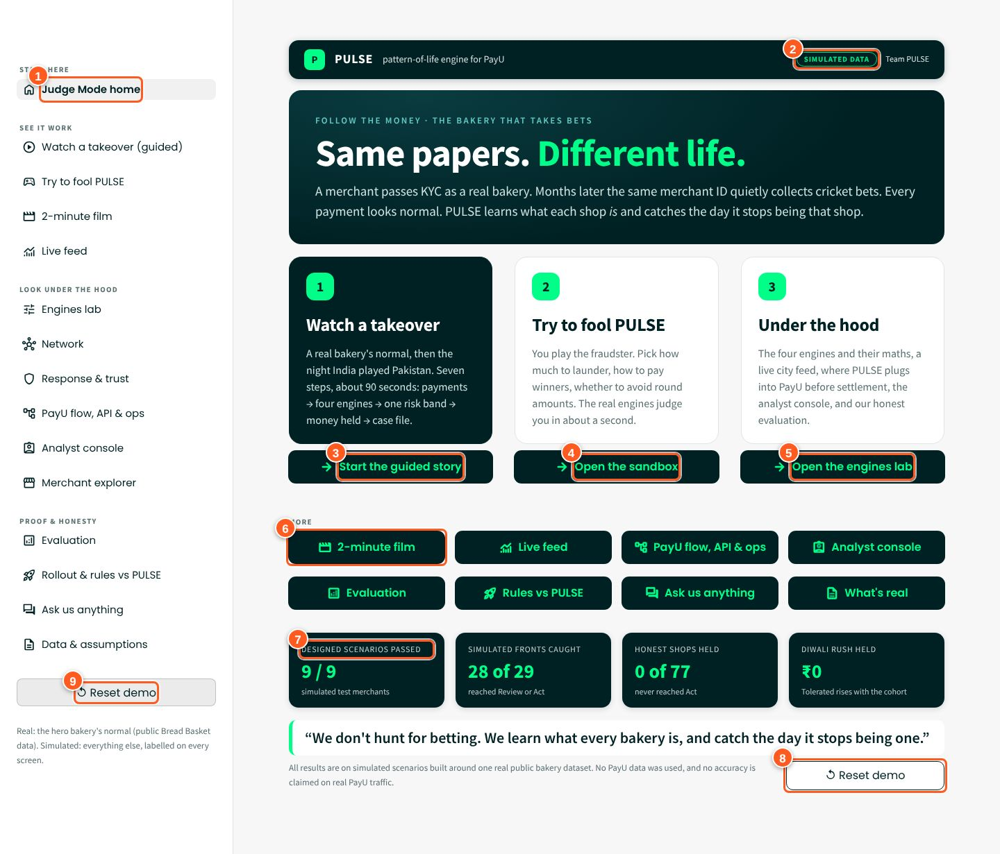

1. **Sidebar.** The menu on the left, in four groups (below). The page you're on is highlighted. On a phone the sidebar is hidden; tap the **›** arrow at the top left to open it.
2. **Header pill "SIMULATED DATA"** and the team name. On every page.
3. to 5. The three big choices on Judge Mode (section 6.1).
6. **More** links to the other screens.
7. Headline numbers, read live from the results files.
8. and 9. **Reset demo.** Clears everything a visitor changed (sandbox settings, analyst decisions, the live feed) and returns to Judge Mode. **Press it between judges.**

**The sidebar groups:**

| Group | Pages | Use it for |
|---|---|---|
| **Start here** | Judge Mode home | The first screen for every judge. |
| **See it work** | Watch a takeover (guided), Try to fool PULSE, 2-minute film, Live feed | The demo itself. |
| **Look under the hood** | Engines lab, Network, Response & trust, PayU flow, API & ops, Analyst console, Merchant explorer | Deeper questions: maths, operations, what the analyst and merchant see. |
| **Proof & honesty** | Evaluation, Rollout & rules vs PULSE, Ask us anything, Data & assumptions | Results, safety, what's real. |

**Every page has its own web address** (route). That means you can type it, bookmark it or put it in a QR code:

`/present` Judge Mode · `/story` guided takeover · `/sandbox` Try to fool PULSE · `/film` 2-minute film · `/live`
live feed · `/flow` PayU flow, API & ops · `/analyst` analyst console · `/engines` engines lab · `/network` ·
`/response` · `/explorer` merchant explorer · `/evaluation` · `/rollout` · `/qa` ask us anything · `/data`

---

## 6. Screen by screen, with pictures

### 6.1 Judge Mode home (`/present`)

This is the front door, shown in the picture above (section 5). It's what the poster QR opens.

- **The hero band** says the whole idea: *"Same papers. Different life."*
- **Tile 1, Watch a takeover → Start the guided story.** The 7-step story of the bakery being taken over (6.2). **Start here with almost every judge.**
- **Tile 2, Try to fool PULSE → Open the sandbox.** The judge plays the fraudster (6.3).
- **Tile 3, Under the hood → Open the engines lab.** The maths (6.7).
- **More:** quick links to the film, live feed, PayU flow, analyst console, evaluation, rules vs PULSE, Q&A, and What's real.
- **The four numbers** (all simulated): **9 / 9** designed scenarios pass; **28 of 29** test fronts reach Review or Act; **0 of 77** honest test shops ever reach Act; **₹0** held from the Diwali rush.
- **The quote** at the bottom is the closing line.

**Say:** "A merchant passes KYC as a real bakery. Months later the same merchant ID quietly takes cricket bets. Every
payment looks normal. PULSE learns what each shop *is* and catches the day it stops being that shop. Want to watch it,
or try to fool it?"

### 6.2 Watch a takeover: the guided story (`/story`)

Seven steps. Move with **Next →** and **← Back** at the bottom, or click any step in the strip at the top. At a
comfortable speaking pace the whole story takes under 2 minutes (we timed the clicks: 15 seconds without talking).

#### Step 1: Meet the bakery

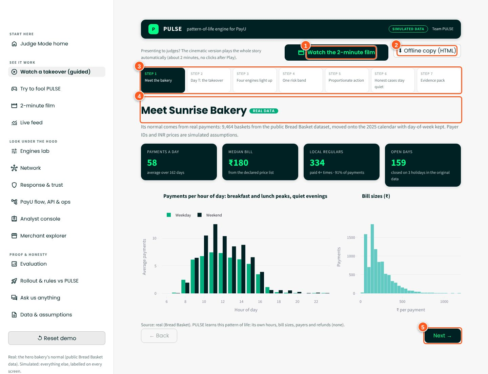

1. **Watch the 2-minute film**: the hands-free cinematic version (6.4).
2. **Offline copy (HTML)**: downloads the film as one file that plays in any browser, even with no app running.
3. **The step strip**: click any step to jump there. The dark one is where you are.
4. **The title with a "REAL DATA" badge.** This is the only step built purely on real data.
5. **Next →** moves to step 2.

**What's on screen:** 58 payments a day on average over 162 days; median bill ₹180; 334 local regulars who make 91% of
payments; 159 open days. The left chart shows the breakfast and lunch peaks and quiet evenings (weekday vs weekend).
The right chart shows bill sizes.

**Say:** "This is a real bakery's pattern of life, from public transaction data. PULSE learns exactly this: its hours,
its bill sizes, its regulars, and that it never gives refunds."

#### Step 2: Day T, the takeover

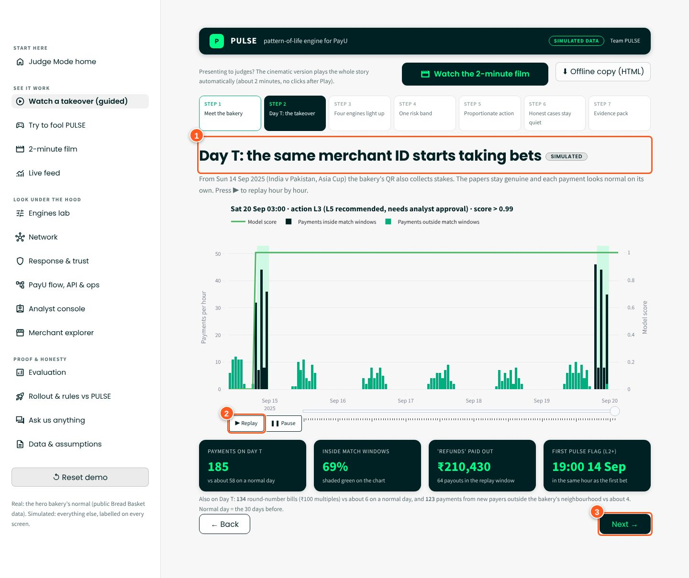

1. **The title.** Day T is Sunday 14 September 2025, India v Pakistan (Asia Cup).
2. **▶ Replay** animates the week hour by hour (**❚❚ Pause** stops it). Dark bars = payments inside match windows, green = outside. The line is the model score.
3. **Next →**.

**What's on screen:** 185 payments on Day T (vs about 58 normally); **69%** of them inside match windows; ₹2,10,430
paid out as "refunds" (64 payouts in the replay window); first PULSE flag at **19:00 on 14 Sep, the same hour as the
first bet**. The note under the tiles: 134 round-number bills vs about 6 on a normal day, and 123 payments from new
payers outside the neighbourhood vs about 4.

**Say:** "Same bakery ID, same papers. Now 69% of the day's payments land inside match windows, with round bills and
strangers from other cities. PULSE flags it in the same hour the bets start."

#### Step 3: Four engines light up

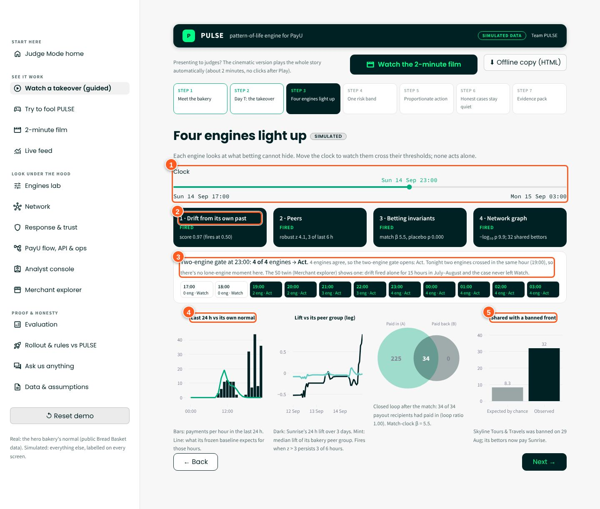

1. **The clock slider.** Drag it from 17:00 to 03:00 to watch each engine cross its threshold.
2. **The four engine tiles** (Drift, Peers, Betting invariants, Network graph). Each says FIRED or not, with its reading.
3. **The two-engine gate.** The strip of hours shows how many engines agree each hour and the resulting band. **One engine alone can never act.** Here two engines cross together at 19:00, so there's no lone-engine moment that night. The S0 twin shows one: drift fired alone for 15 hours in July–August and the case never left Watch.
4. **Charts, one per engine**: the last 24 h vs the shop's own normal (drift); its lift vs its peers (peers); a Venn diagram of people who paid in and people who got paid back (closed loop); and shared bettors with a banned front (graph).
5. **Shared with a banned front**: 32 shared bettors observed vs 8.3 expected by chance.

**Say:** "Four engines look at what betting can't hide. Drift: unlike its own past. Peers: other bakeries didn't
surge. Invariants: a match clock tested against placebo dates, and winners paid back as 'refunds'. Graph: its customers
are bettors of a front we already banned. Two must agree before anything happens."

#### Step 4: One risk band, three plain reasons

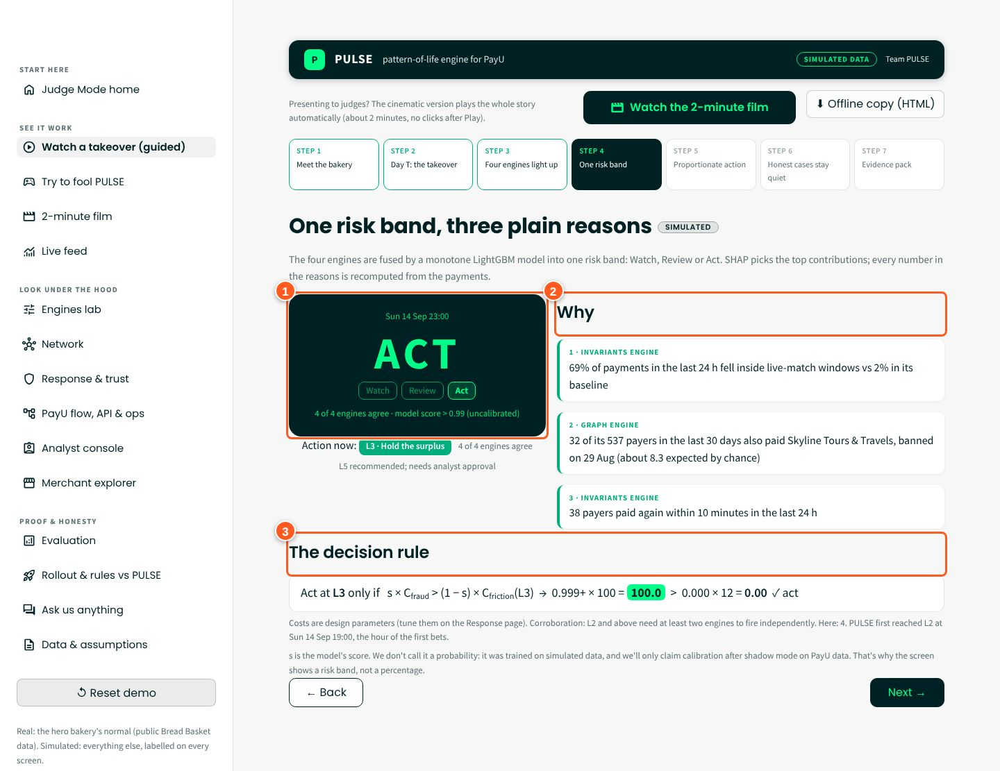

1. **The band card**: ACT, with the three bands Watch / Review / Act. Under it: 4 of 4 engines agree, model score > 0.99 *(uncalibrated)*, action now **L3 · Hold the surplus**, L5 recommended (needs an analyst).
2. **Why**: the top three reasons in plain English, each tagged with its engine. Every number in them is recomputed from the payments (a test checks this).
3. **The decision rule**: act at L3 only if *s × C_fraud > (1 − s) × C_friction(L3)*. Here 0.999 × 100 = 100 > 0.000 × 12 = 0, so act.

**Say:** "We don't claim a probability, because the model was trained on simulated data. We give a band and three
reasons an analyst can check."

#### Step 5: Proportionate action

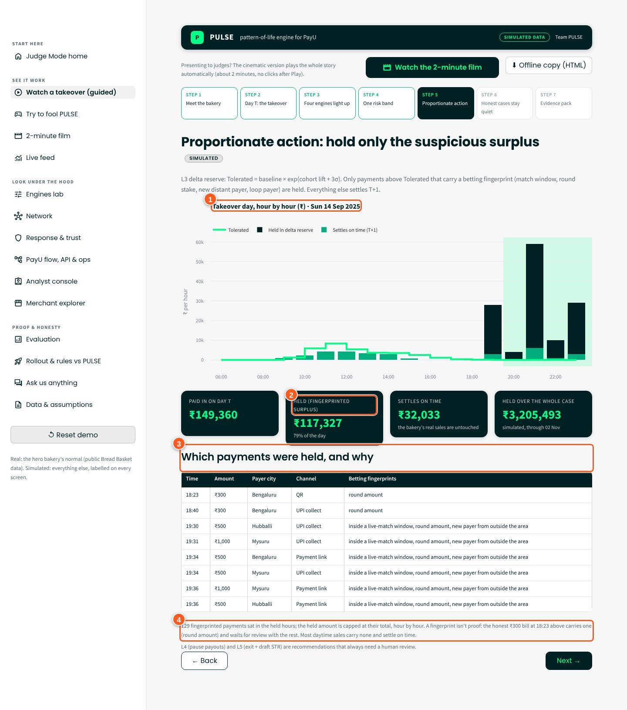

1. **The takeover day, hour by hour.** The green line is **Tolerated**, the most the shop could plausibly take in honestly. Dark bars are held; green bars settle on time.
2. **The money tiles**: paid in on Day T **₹1,49,360**; held **₹1,17,327** (79% of the day); settles on time **₹32,033**; held over the whole case ₹32,05,493 (simulated, through 2 Nov).
3. **Which payments were held, and why**: a table of real rows from the simulation: time, amount, payer city, channel, and which fingerprints each payment carries.
4. **The fairness note**: a fingerprint isn't proof. The honest ₹300 bill at 18:23 carries one (round amount) and waits for review with the rest.

**Say:** "We don't freeze the bakery. We hold only the surplus above a festival-aware level, and only payments that
carry a betting fingerprint. Its real daytime sales settle on time. L4 and L5 always need a human."

#### Step 6: Honest cases stay quiet

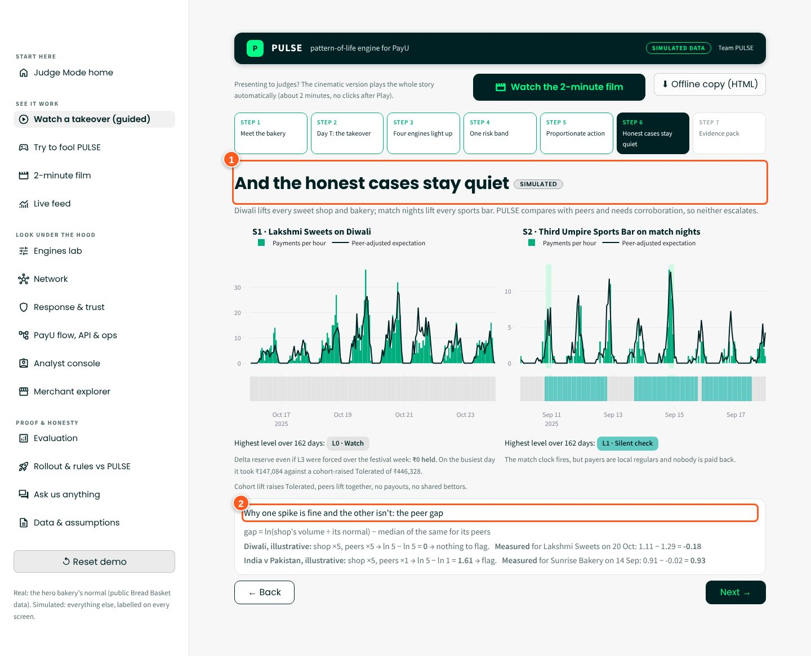

1. **Two honest merchants.** Left: **S1 Lakshmi Sweets on Diwali**. Highest level over 162 days: **L0 · Watch**. Even if L3 were forced over the festival week, ₹0 would be held: on the busiest day it took ₹1,47,084 against a cohort-raised Tolerated of ₹4,46,328. Right: **S2 Third Umpire Sports Bar** on match nights: highest level **L1 · Silent check**. The match clock fires, but its payers are local regulars and nobody is paid back.
2. **The peer gap.** gap = ln(shop's volume ÷ its normal) − the same for its peers. *Diwali (illustrative):* shop ×5, peers ×5 → ln 5 − ln 5 = **0**, nothing to flag. *India v Pakistan (illustrative):* shop ×5, peers ×1 → ln 5 − ln 1 = **1.61**, flag. *Measured:* Lakshmi Sweets on 20 Oct: 1.11 − 1.29 = **−0.18**; Sunrise Bakery on 14 Sep: 0.91 − (−0.02) = **0.93**.

**Say:** "On Diwali every sweet shop jumps, so the gap to its peers stays near zero and we hold nothing. The sports bar
is busy every match night, but it has no strangers and no refunds, so it never goes past a silent check."

#### Step 7: Evidence pack

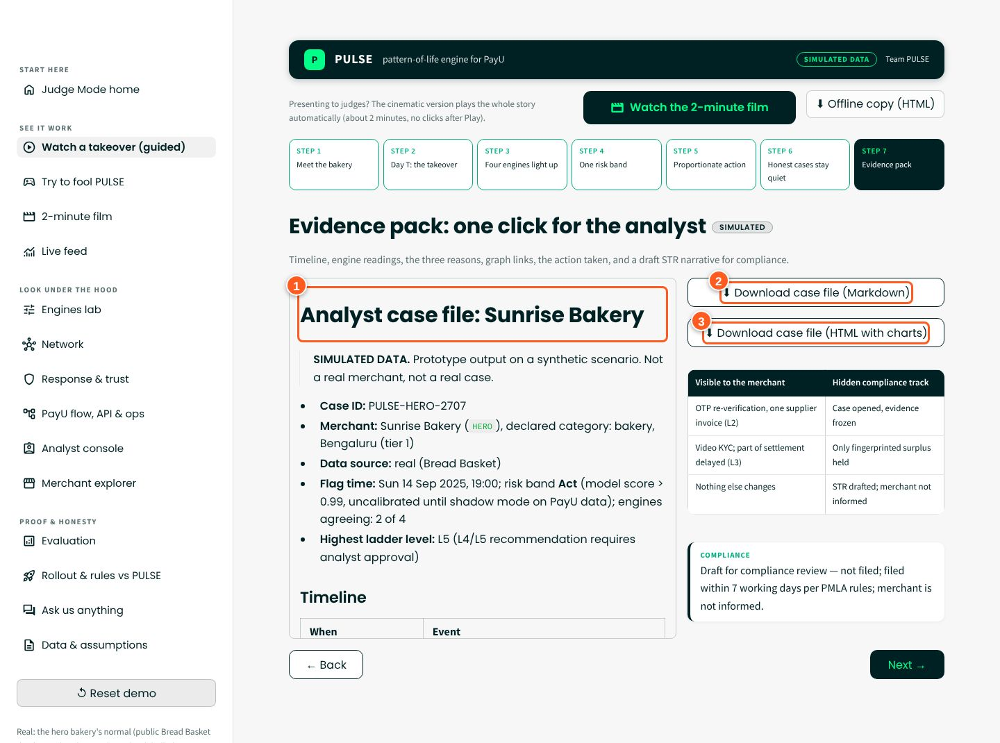

1. **The analyst case file**, generated from the data: case ID, flag time, band, timeline, top three reasons, engine readings, graph links to banned fronts, money movement in the week before the flag, the action taken on both tracks, and a draft STR narrative.
2. and 3. **Download** it as Markdown or as HTML with charts.

The right side shows the **two tracks**: what the merchant sees (OTP re-verification at L2; video KYC and part of
settlement delayed at L3) and the hidden compliance track (case opened, evidence frozen, STR drafted, merchant not
informed). The compliance box says the STR is a draft for human review, filed within 7 working days per PMLA rules,
and the merchant is never told (telling them would be "tipping off", which the law forbids).

**Say:** "One click gives the analyst a complete case file. PULSE never files anything itself."

### 6.3 Try to fool PULSE: the sandbox (`/sandbox`)

The judge plays the fraudster. The app builds a fresh simulated world (their shop plus 20 peer shops, 60 days) and runs
**the same engine code** as the full pipeline on it. One run takes about a second.

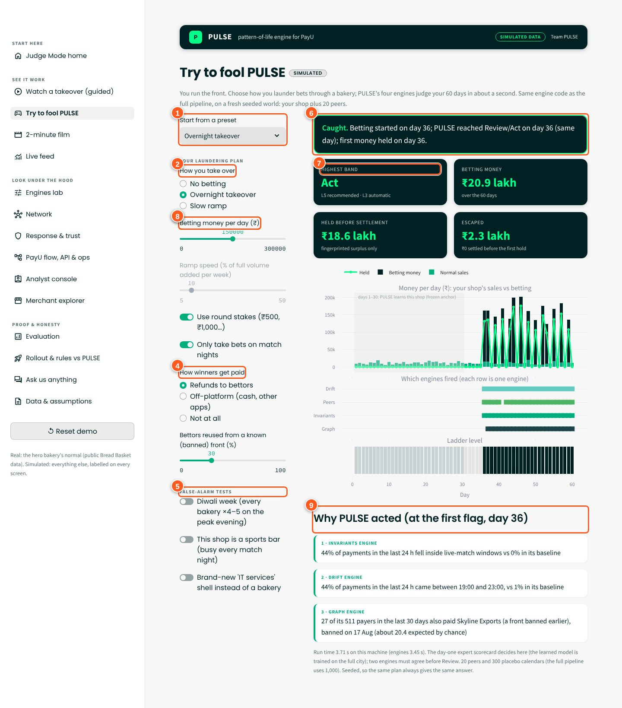

1. **Start from a preset.** Seven ready-made plans (below). Choosing one sets all the controls.
2. **How you take over**: no betting, an overnight takeover, or a slow ramp.
3. **Betting money per day** (₹0 to ₹3,00,000). Below it: ramp speed (only for a slow ramp), round stakes on/off, bets only on match nights on/off.
4. **How winners get paid**: refunds through PayU, off-platform (cash or other apps), or not at all. Below it: what share of bettors are reused from a known (banned) front.
5. **False-alarm tests**: switch on Diwali week, make the shop a sports bar, or make it a brand-new "IT services" shell.
6. **The verdict banner**: *Caught* (with the day betting started, the day PULSE reached Review/Act, and the first day money was held) or *You got through*.
7. **Four tiles**: highest band, betting money, money held before settlement, money that escaped.
8. **The chart**: top, money per day (normal sales, betting money, held); middle, which engines fired, one row each; bottom, the ladder level per day. Days 1–30 are shaded: PULSE is learning the shop.
9. **Why PULSE acted**: the three reasons at the first flag.

**The presets and what they do** (measured; days counted from 1):

| Preset | Result | Betting | Held | Escaped |
|---|---|---|---|---|
| Honest bakery | Stays at Watch (L0) | none | ₹0 | – |
| Diwali rush | Stays at Watch (L0) | none | ₹0 | – |
| Sports bar | Stays at Watch (L0) | none | ₹0 | – |
| Overnight takeover | Bets from day 36, caught **day 36**, held day 36 | ₹20.9 lakh | ₹18.6 lakh | ₹2.3 lakh |
| Slow ramp | Bets from day 32, caught **day 39** | ₹5.8 lakh | ₹3.3 lakh | ₹2.5 lakh |
| New shell | Bets from day 41, caught and held **day 41** | ₹6.2 lakh | ₹5.9 lakh | ₹0.3 lakh |
| Careful front | Bets from day 36, caught **day 37**, but more than half escapes | ₹7.5 lakh | ₹3.2 lakh | ₹4.3 lakh |

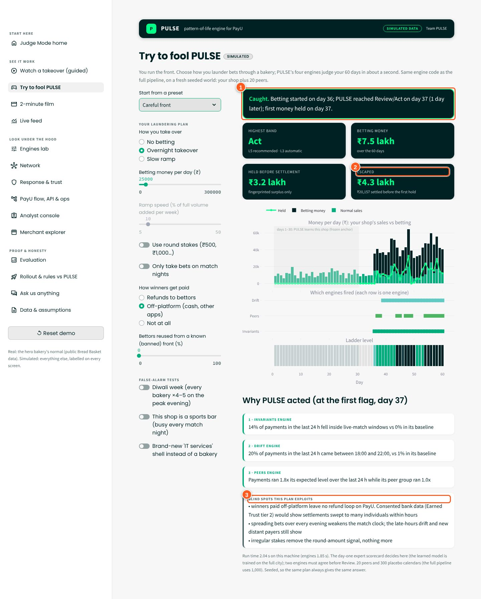

1. **Caught a day after the first bet.**
2. **Escaped ₹4.3 lakh**: most of the money. This is the honest weak spot.
3. **Blind spots this plan exploits**: winners paid off-platform leave no refund loop on PayU; spreading bets over every evening weakens the match clock; irregular stakes remove the round-amount signal. The page also says what would close each gap (for example, consented bank data under Earned Trust).

**Say:** "Try to beat it. Pick a preset or build your own plan. This is the real engine code, running now. And if you
find a way through, the page tells you why, because we'd rather show our blind spots than hide them."

### 6.4 The 2-minute film (`/film`)

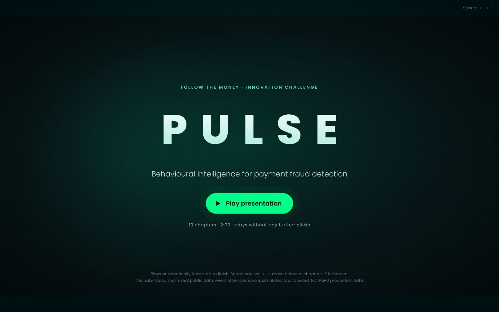

A hands-free cinematic version of the whole story: 10 chapters, exactly 2:00, no clicks after **Play**. It uses the same numbers as the app.

- **Space** pauses, **← →** move between chapters, **R** replays, **F** fullscreen, **X** exits (back to `/present`).
- Use it when the stall is busy and you can't talk to everyone, or for a judge who wants to just watch.

### 6.5 Live feed (`/live`)

A simulated mini-city of 24 shops (bakeries, sweet shops, sports bars, kiranas) plays forward hour by hour. Every
tile is scored by the four engines using only payments up to the current hour, exactly what a live system would see.

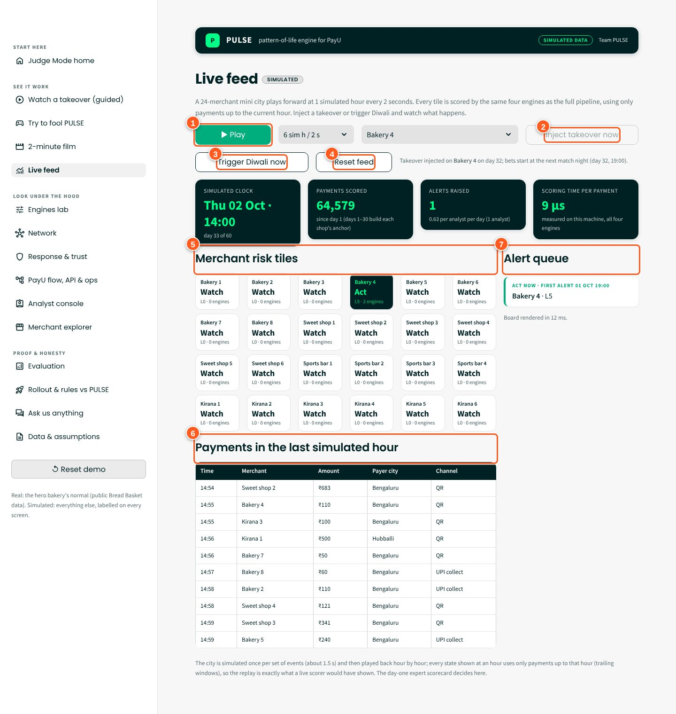

1. **▶ Play / ❚❚ Pause.** Next to it: speed (1, 3 or 6 simulated hours every 2 seconds) and which shop to take over.
2. **Inject takeover now**: turns the chosen shop (Bakery 4 by default) into a front from the next match night.
3. **Trigger Diwali now**: starts a festival week for every shop.
4. **Reset feed**: starts the city again.
5. **Merchant risk tiles**: one per shop, with its band (Watch / Review / Act), level and number of engines firing. In the picture, Bakery 4 has turned **Act** (L5 recommended, 2 engines).
6. **Payments in the last simulated hour**: real rows from the simulation.
7. **Alert queue**: the cases that need an analyst, with the time of the first alert.

The four counters are **measured, not typed in**: the simulated clock, payments scored so far, alerts raised (and
alerts per analyst per day), and scoring time per payment (about 11 microseconds on this laptop).

**Say:** "Here's a city running live. I'll inject a takeover into Bakery 4... and at its first match night it turns
Act. Now watch Diwali: every sweet shop jumps, and none of them turns."

### 6.6 PayU flow, scoring API & ops (`/flow`)

Four tabs that answer "how would PayU actually run this?"

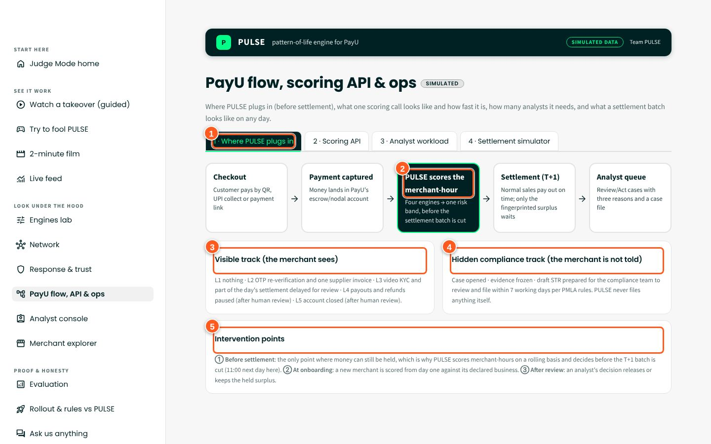

1. **Tab 1, Where PULSE plugs in.**
2. **The flow**: checkout → payment captured → **PULSE scores the merchant-hour** → settlement (T+1) → analyst queue. PULSE sits *before* the settlement batch, the only point where money can still be held.
3. **Visible track**: what the merchant sees at each level.
4. **Hidden compliance track**: what compliance does without telling the merchant.
5. **Intervention points**: before settlement (hold), at onboarding (score new merchants from day one against their declared business), after review (release or keep).

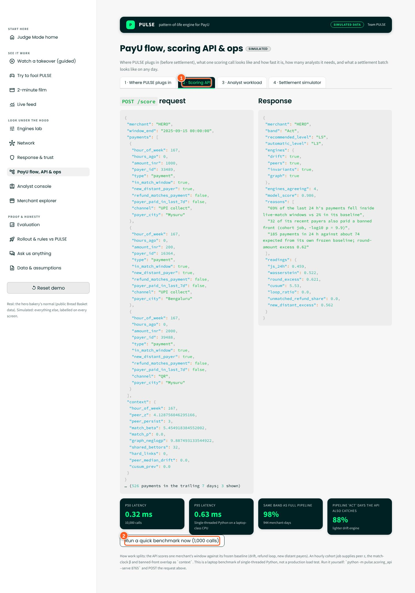

1. **Tab 2, Scoring API.** A real example of a `POST /score` request (the bakery's last 7 days of payments plus context from the hourly peer job) and the response: band Act, recommended L5, automatic L3, which engines fired, the model score, three reasons and the raw readings.
2. **Run a quick benchmark now** re-measures speed live. The saved benchmark: **0.32 ms per call at p50, 0.63 ms at p95** (10,000 calls, single-threaded Python on a laptop), the same band as the full pipeline on **98%** of merchant-days, and **88%** of the pipeline's Act days also caught by the API. This is a laptop benchmark, not a production claim.

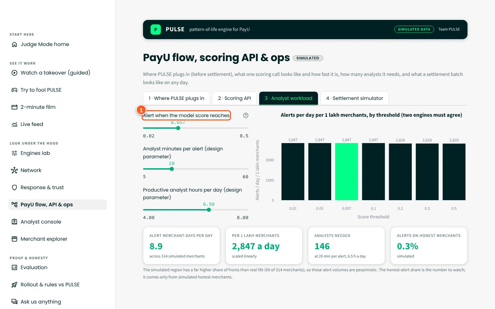

1. **Tab 3, Analyst workload.** Move the alert threshold and the analyst sliders (minutes per alert and hours a day are design parameters, labelled as such). The tiles show alerts per day, alerts per 1 lakh merchants, analysts needed, and the share of alerts on honest merchants (0.3%, simulated).
   - **Read it honestly:** our simulated region has far more fronts than real life (60 of 314 merchants), so the alert volume is pessimistic. The number that matters is the honest share.

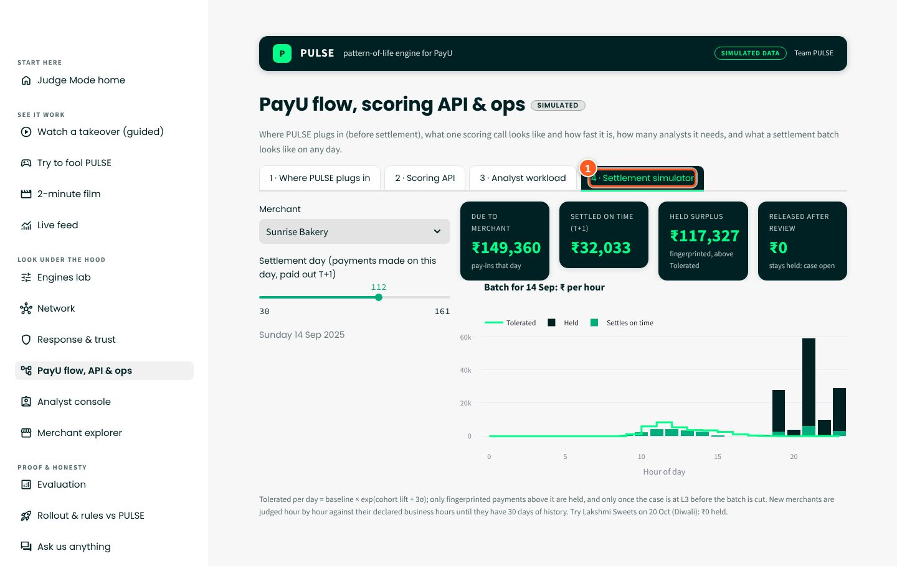

1. **Tab 4, Settlement simulator.** Pick any merchant and any day. The tiles show what was due to the merchant, what settled on time, the held surplus, and what was released after review. Example: Sunrise Bakery on 14 Sep: due ₹1,49,360, settled ₹32,033, held ₹1,17,327. Try Lakshmi Sweets on 20 Oct (Diwali): ₹0 held.

### 6.7 Analyst console (`/analyst`)

What a PayU analyst would see.

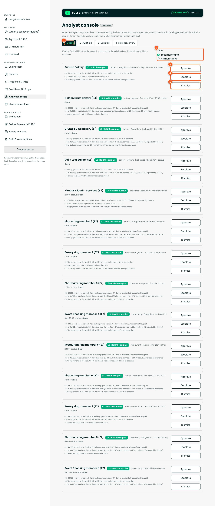

1. **Tab 1, Queue**: flagged merchants sorted by risk band, each with three plain reasons.
2. **Show**: test merchants only, or all merchants.
3. to 5. **Approve / Escalate / Dismiss**. Each click is written to the audit log.

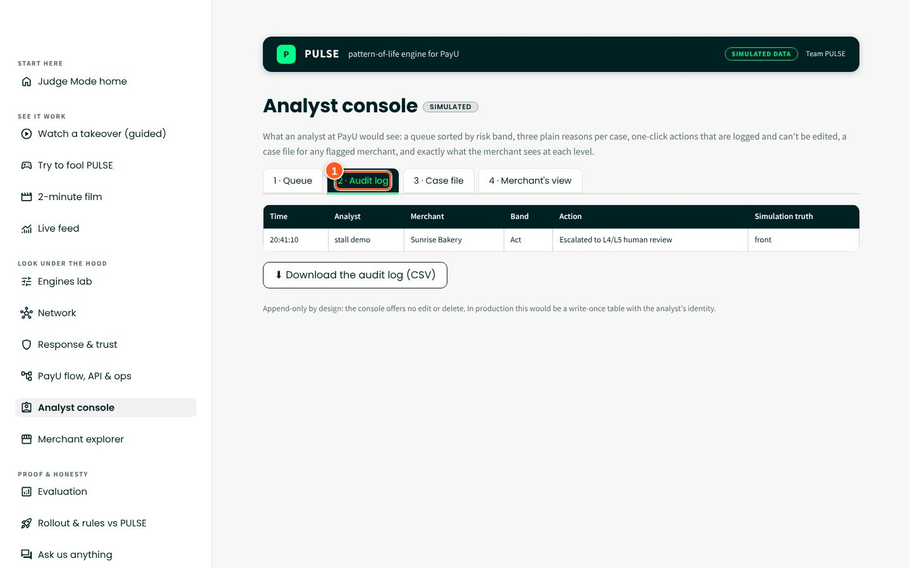

1. **Tab 2, Audit log**: every decision with time, analyst, merchant, band, action, and (only because this is a simulation) the truth. It's append-only: there is no edit or delete. **Download the audit log (CSV)** exports it.

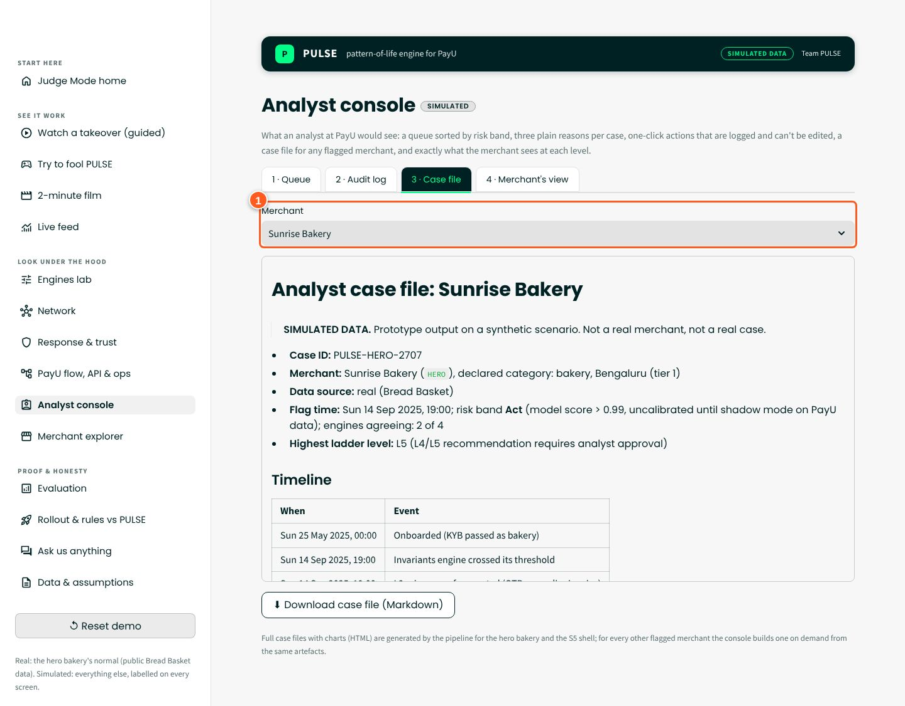

1. **Tab 3, Case file**: pick any flagged merchant to get the full case file (the same format as story step 7).

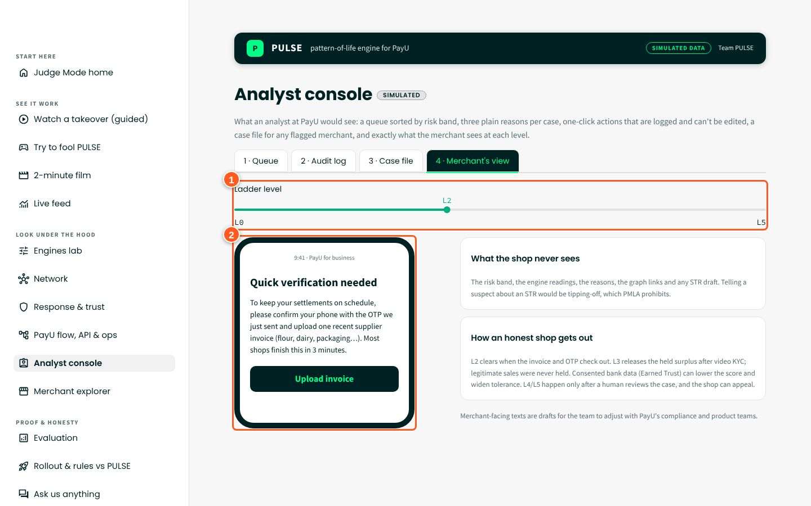

1. **Tab 4, Merchant's view**: drag the ladder level from L0 to L5.
2. **The phone screen** shows exactly what the shop owner sees at that level (for example at L2: "Quick verification needed", upload a supplier invoice). The right side explains what the shop never sees and how an honest shop gets out. The merchant-facing texts are drafts for PayU's compliance and product teams.

### 6.8 Engines lab (`/engines`)

One tab per engine, with sliders that recompute live. The maths behind each is in section 7.

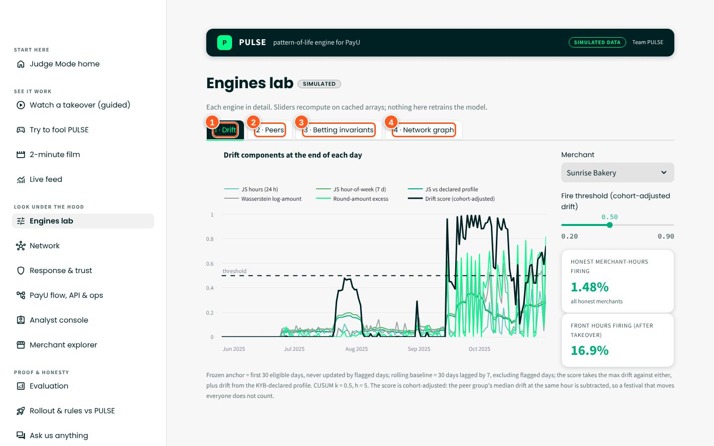

1. **Drift**: the drift components day by day for any merchant (JS divergence of hours, Wasserstein on amounts, round-amount excess, CUSUM, and the combined cohort-adjusted score), with a fire-threshold slider. The tiles show how often honest merchant-hours fire (1.48%) vs front hours after takeover (16.9%). Drift alone is weak, which is why no engine acts alone.
2. to 4. The other three tabs.

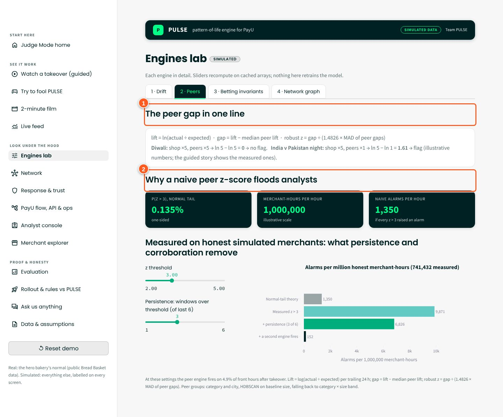

1. **The peer gap in one line**, with the Diwali vs India–Pakistan example.
2. **Why a naive peer z-score floods analysts**: if z > 3 were an alarm, the normal tail is 0.135%, which is 1,350 alarms an hour per million merchant-hours. The bar chart shows what was **measured** on honest simulated merchants: z > 3 alone, then + persistence (3 of the last 6 hours), then + a second engine. That last step brings it down to 152 per million.

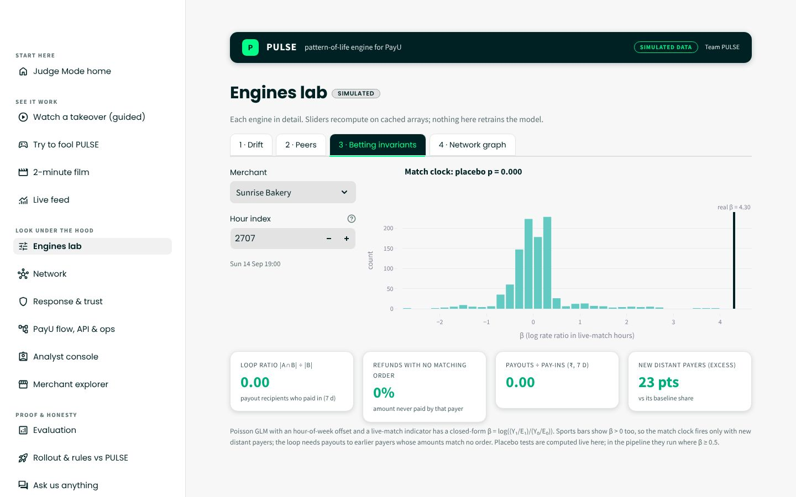

**Betting invariants**: the match clock for any merchant and hour. The histogram shows β for 1,000 placebo calendars
(fake match dates); the dark line is the real β. If the real one sits far to the right of almost all placebos (here
p = 0.000), the shop really does take more payments when matches are live. The tiles show the loop ratio, refunds with
no matching order, payouts vs pay-ins, and new distant payers.

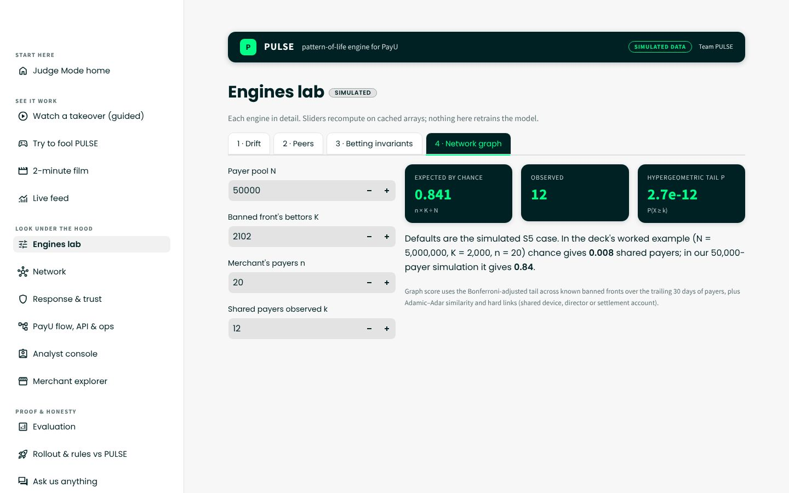

**Network graph**: the hypergeometric calculator. Type in the payer pool N, the banned front's bettors K, the
merchant's payers n and the shared payers observed k. It shows how many shared payers to expect by chance (n × K ÷ N),
and the probability of seeing k or more by chance. Defaults are the S5 shell: 12 shared vs 0.84 expected, p ≈ 2.7 × 10⁻¹².

### 6.9 Network (`/network`)

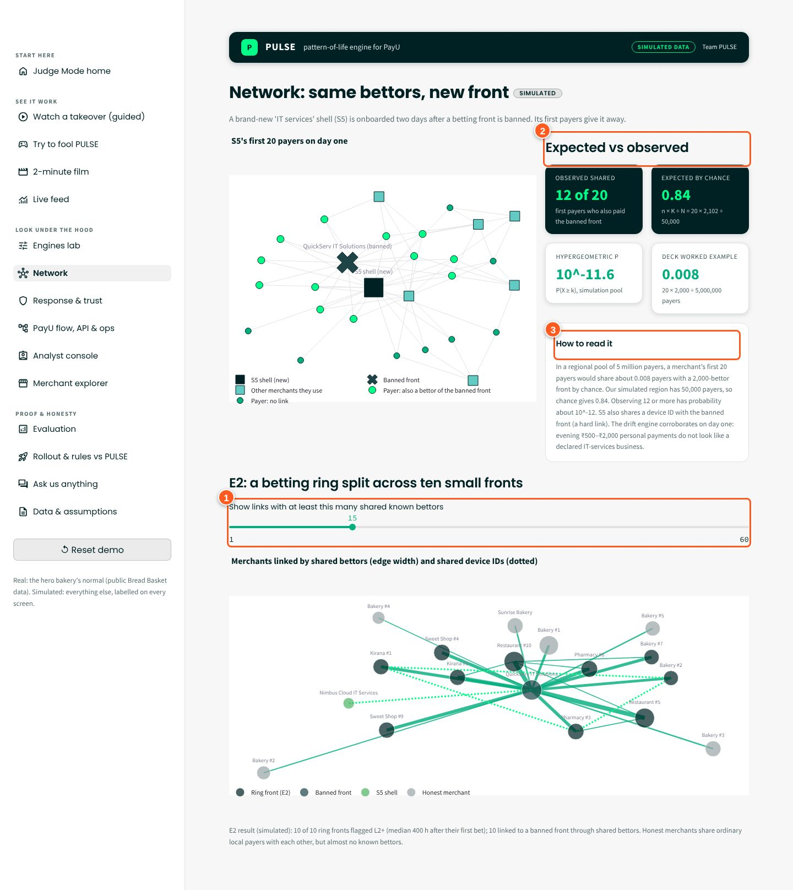

The top half is the **S5 shell** (Nimbus Cloud IT Services), onboarded two days after a front (QuickServ IT Solutions)
was banned. Its first 20 payers: **12** were bettors of the banned front, where chance predicts **0.84**. It also shares
a device ID with the banned front (a hard link).

1. **The slider** filters the ring diagram below by the number of shared known bettors.
2. **Expected vs observed** tiles, including the deck's worked example: in a pool of 5 million payers, chance would give 0.008.
3. **How to read it**.

The bottom diagram is **E2**, a betting ring split across ten small fronts, linked by shared bettors (edge width) and
shared device IDs (dotted). All 10 ring fronts reach L2+.

### 6.10 Response & trust (`/response`)

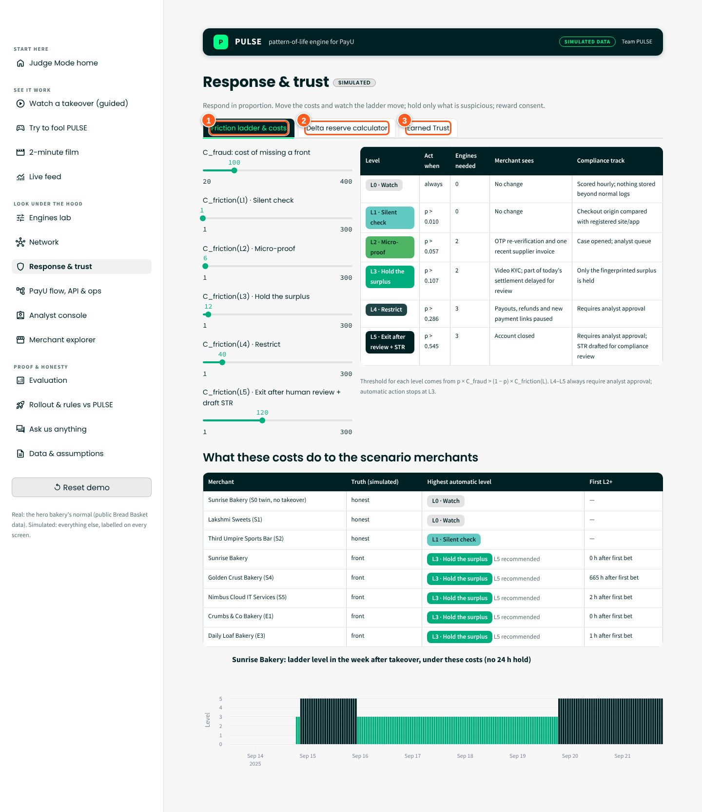

1. **Friction ladder & costs**: the six levels, the score each needs, how many engines must agree, what the merchant sees and what compliance does. Cost sliders let you change C_fraud and the friction costs; the ladder moves.
2. **Delta reserve calculator** (picture below).
3. **Earned Trust**.

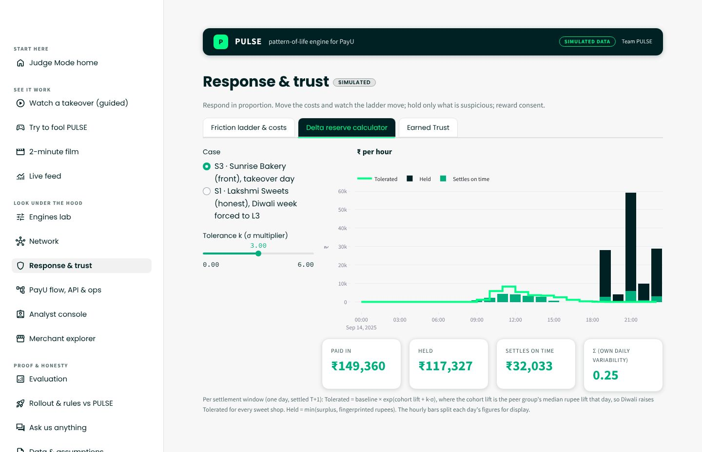

Pick the takeover day (S3) or Diwali week forced to L3 (S1), and move the tolerance k. The chart shows Tolerated, held
and settled per hour. At k = 3 the takeover day holds ₹1,17,327 of ₹1,49,360; Diwali holds ₹0.

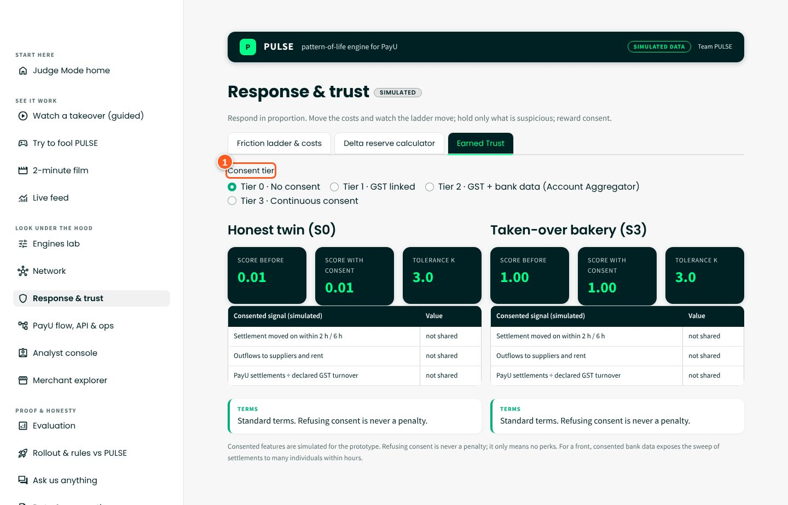

1. **Consent tier 0–3.** A merchant who shares more data (GST, then bank data through the Account Aggregator, then continuous consent) gets better terms: guaranteed or same-day settlement and a wider tolerance (k from 3 up to 4.5). **Refusing consent is never a penalty.** Compare the honest twin with the front: the honest shop benefits, the front's bank data shows money swept out to many individuals.

### 6.11 Merchant explorer (`/explorer`)

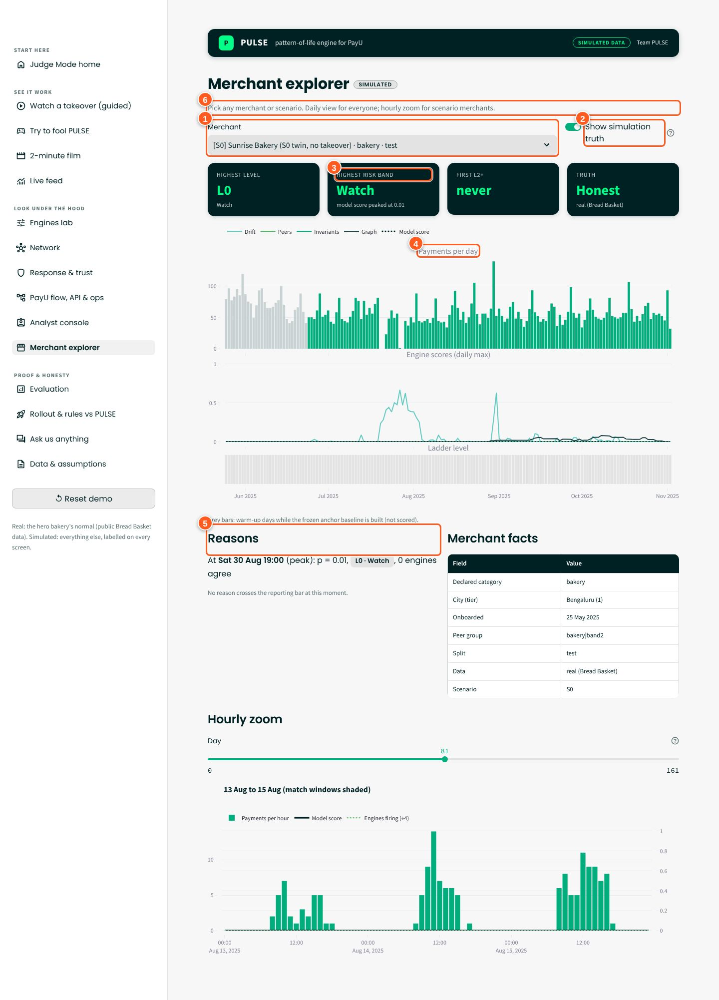

1. **Pick any of the 314 merchants**, including every scenario (tagged [S0], [S3], [E2] and so on).
2. **Show simulation truth**: reveals which shops are really fronts (possible only because it's a simulation).
3. **Tiles**: highest level, highest risk band, first L2+, truth.
4. **The timeline**: payments per day, the four engine scores and the model score, the ladder level per day.
5. **Reasons** at the first flag, and merchant facts.
6. **Hourly zoom** (for scenario merchants): drag the day slider.

### 6.12 Evaluation (`/evaluation`)

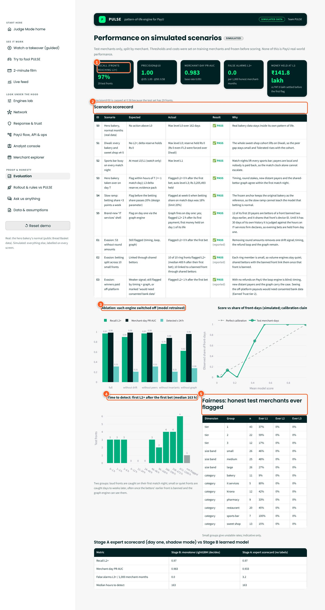

1. **Headline metrics**, on test merchants only: recall 97% (28 of 29 fronts reach L2+); precision@10 = 1.00; merchant-day PR-AUC 0.983 (base rate 0.091); 0.0 false alarms at L3+ per 1,000 honest merchant-months; ₹1.4 crore held at L3 vs ₹47 lakh settled before the first flag.
2. **Scenario scorecard**: every designed scenario with expected vs actual and PASS/FAIL (section 9).
3. **Ablation**: each engine switched off and the model retrained. Shows which engines carry the signal.
4. **Time to detect**: hours from the first bet to the first L2+. Median 163 h: loud fronts are caught on their first match night, quiet ones take days to weeks.
5. **Fairness**: share of honest test merchants ever flagged, by city tier, category and size.

Further down: score vs observed share of front-days (labelled "calibration claimed only after shadow mode"), and the
day-one expert scorecard (Stage A) compared with the learned model (Stage B).

### 6.13 Rollout & rules vs PULSE (`/rollout`)

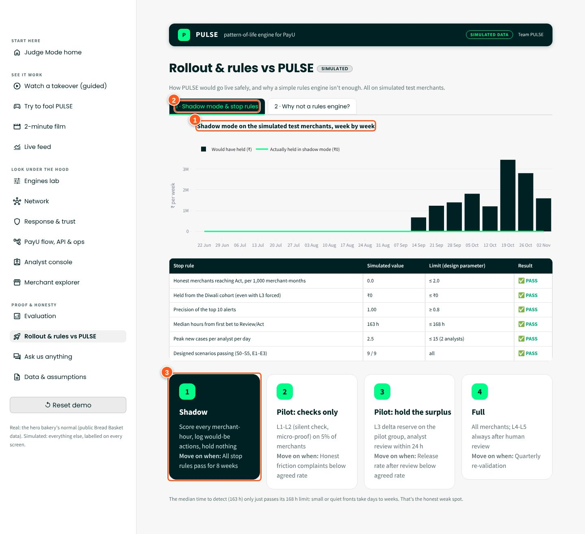

1. **Shadow mode, week by week**: what PULSE *would* have held (bars) vs what it actually held in shadow mode (₹0).
2. **Stop rules**: six written rules with limits (design parameters from `config/costs.yaml`), each PASS/FAIL: honest merchants at Act ≤ 2 per 1,000 merchant-months (0.0); Diwali cohort held ≤ ₹0 (₹0); precision of the top 10 ≥ 0.8 (1.00); median hours to Review/Act ≤ 168 (163, only just passes); peak new cases per analyst per day ≤ 15 (2.5); designed scenarios passing: all (9/9).
3. **Four rollout stages**: Shadow → Pilot (checks only) → Pilot (hold the surplus) → Full, each with "move on when".

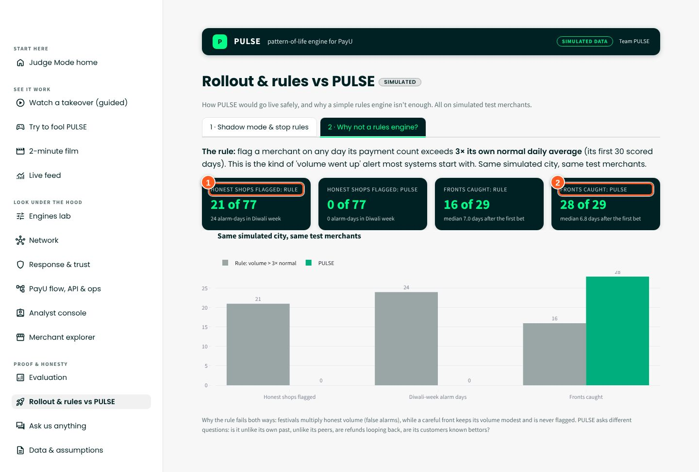

1. **The rule** most systems start with: flag any day a merchant's payment count goes over 3× its first-30-day average. On the same test merchants it flags **21 of 77** honest shops (24 alarm-days in Diwali week) and catches **16 of 29** fronts.
2. **PULSE**: **0 of 77** honest shops at Act, **0** Diwali alarm-days, **28 of 29** fronts caught.

**Say:** "Volume rules fail both ways. Festivals multiply honest volume, and a careful front keeps its volume modest.
PULSE asks different questions."

### 6.14 Ask us anything (`/qa`)

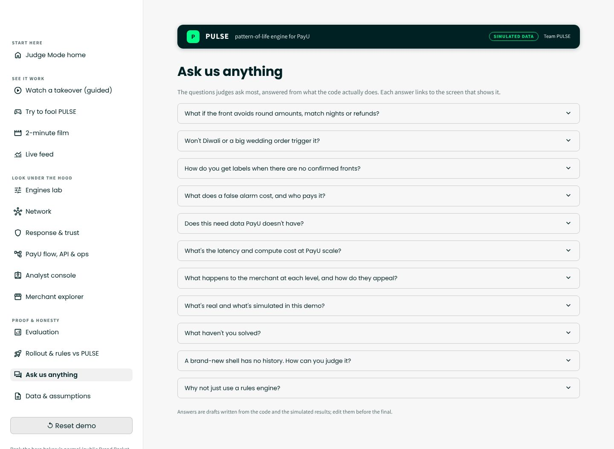

Eleven hard questions with honest answers, each with a link to the page that proves it: evasion, Diwali, where labels
come from, the cost of a false alarm, data PayU doesn't have, latency at scale, what the merchant sees and how they
appeal, what's real, what we haven't solved, brand-new shells, and why not a rules engine. **Read this page before the stall.**

### 6.15 Data & assumptions (`/data`)

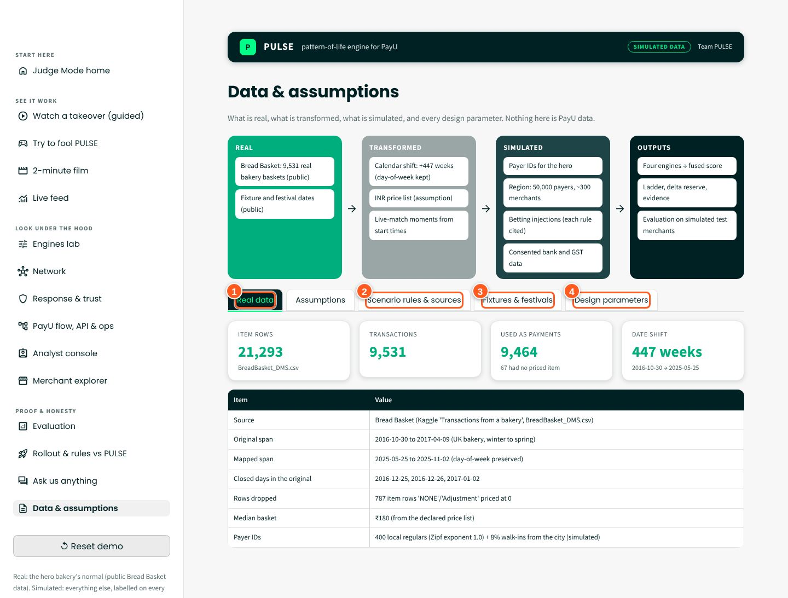

1. **Real data**: the Bread Basket dataset and exactly how we transformed it.
2. **Scenario rules & sources**: every simulated betting rule with the public finding behind it.
3. **Fixtures & festivals**: the match and festival calendar, with a "to be verified by team" column.
4. **Design parameters**: every number we chose (thresholds, costs, multipliers).

### 6.16 On a phone

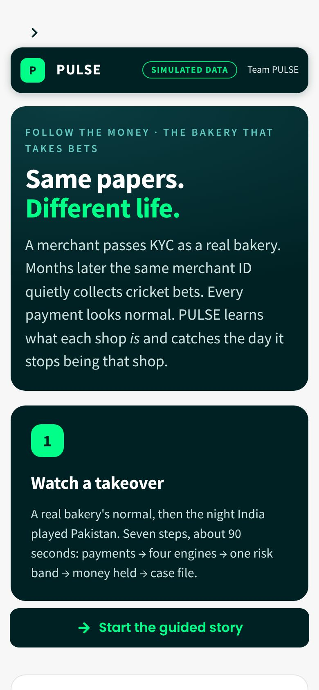

At phone width the sidebar hides (tap **›** at the top left), the tiles stack, and the header fits. Judge Mode and the
sandbox are the two screens designed for phones.

---

## 7. How PULSE works: the maths in plain words

Four steps: **learn the normal → four engines look for evidence → fuse into one band → respond in proportion.**
Everything runs on an hourly grid: each hour, for each merchant, we look back over a trailing window (24 hours, 7
days, 14 days or 30 days, depending on the engine).

### 7.1 Learning the normal (the baseline)

For each merchant PULSE learns, from its first **30 days**, when it gets paid (hour of the week), how much (bill
sizes), how often amounts are round, who pays (local regulars or strangers), and whether it ever pays anyone back.

- **Frozen anchor.** The first 30 days are frozen and never updated by flagged days. This stops a fraudster from slowly "teaching" the system that betting is normal.
- **Rolling baseline.** A second baseline from the last 30 days (lagged by 7, excluding flagged days) catches slow seasonal change. Drift takes the larger difference of the two.
- **New merchants** have no history, so until they have 30 days they are judged against their **declared** business (what they said at signup: hours, bill sizes) and, for holding money, hour by hour (see 7.5).

### 7.2 Engine A, Drift: "is it unlike its own past?"

Compares the last 24 hours (and 7 days) with the merchant's own normal:

- **When it gets paid.** We compare two distributions over the 168 hours of the week with the **Jensen–Shannon (JS) divergence**. It's 0 when the two shapes are identical and rises as they differ. A bakery that suddenly gets paid at 21:00 instead of 09:00 scores high.
- **How much.** The **Wasserstein distance** on log-amounts (how far you'd have to "move" the bill-size histogram to turn one into the other).
- **Round amounts.** The excess share of payments divisible by ₹100 compared with normal. Bets are ₹500 or ₹1,000; bread is ₹137.
- **CUSUM.** A running sum that adds up small, steady increases (k = 0.5, h = 5). Catches a slow ramp that no single day reveals.

These are combined into one drift score from 0 to 1 and **cohort-adjusted**: we subtract the median drift of the
merchant's peers at the same hour, so a festival that moves everyone doesn't count. Fires at **0.5**.

### 7.3 Engine B, Peers: "is it unlike similar shops?"

- **Lift** = ln(actual payments in the last 24 h ÷ expected payments). Using the natural log means ×5 and ÷5 are equally far from normal.
- **Gap** = the shop's lift − the median lift of its peer group.
- **Robust z** = gap ÷ (1.4826 × MAD), where MAD is the median absolute deviation of the peers' gaps. MAD is like a standard deviation that one wild shop can't distort; 1.4826 makes it comparable to one.
- **Fires** only if z > 3 in **at least 3 of the last 6 hours** (persistence).

**Worked example:** on Diwali the shop is ×5 and its peers ×5: gap = ln 5 − ln 5 = 0, no flag. On India v Pakistan
night the bakery is ×5 and its peers ×1: gap = ln 5 − ln 1 = 1.61, a big gap.

**Why persistence and a second engine matter:** if z > 3 alone raised an alarm, a normal distribution exceeds it
0.135% of the time, which is 1,350 alarms an hour across a million merchant-hours. We measured it on honest simulated
merchants: 9,871 per million with z > 3 alone (the real data has fatter tails), 6,826 with persistence, and 152 when a
second engine must also fire.

**Peer groups** are found by clustering (HDBSCAN) on category, city and baseline size, with a fallback to category ×
size band when a cluster is too small.

### 7.4 Engine C, Betting invariants: "does it show things betting can't hide?"

Betting has two habits that a real bakery never has.

**1. The closed loop.** Bettors pay in; winners get paid back. So the same people appear on both sides.
- **Loop ratio** = |A ∩ B| ÷ |B|: of the people who got money back (B), how many had paid in (A)? For a bakery that never refunds, B is empty. In the story the Venn diagram shows 34 of 34 payout recipients had paid in: loop ratio 1.00.
- Also: refunds with no matching order (a refund for an amount nobody paid), and payouts as a share of pay-ins.
- Fires when there are at least 5 payouts, loop ratio ≥ 0.5, unmatched share ≥ 0.5 and payouts ≥ 15% of pay-ins.

**2. The match clock.** Does the shop get paid *more when matches are live*?
- We fit a simple Poisson model: payments per hour = the shop's usual rate for that hour of the week × e^(β × [match is live]). **β** is the log of "how many times more payments during live matches". For the bakery on 14 Sep, β ≈ 5.5 at 23:00.
- **Placebo test:** we shift the match calendar to 1,000 fake dates (at least a week away) and compute β for each. If the real β beats almost all of them, it's not luck. The **placebo p-value** is the share of fake calendars that do as well. Fires if β ≥ 1 and p < 0.05.
- **The sports-bar guard:** a sports bar also has β > 0 (people really do come for matches). So the match clock fires only if there are also **excess new payers from far away**. The sports bar's customers are local regulars; bettors are strangers from other cities.

### 7.5 Engine D, Network graph: "are its customers known bettors?"

When PayU bans a front, its list of bettors (payers) is known. If a "new" merchant's payers overlap heavily with that
list, it's very likely the same operation under a new name.

- **The hypergeometric test.** Out of N payers in the region, K were bettors of the banned front. A merchant has n payers. By pure chance you'd expect n × K ÷ N of them to be on the list. The hypergeometric tail gives the probability of seeing k or more by chance.
- **The S5 shell:** N = 50,000, K = 2,102, n = 20. Expected by chance: 20 × 2,102 ÷ 50,000 = **0.84**. Observed: **12**. Probability of 12 or more by chance: about **10⁻¹²**.
- **The deck's example:** in a real pool of 5 million payers with a 2,000-bettor front, chance gives 20 × 2,000 ÷ 5,000,000 = **0.008** shared payers. Seeing even 3 would be extraordinary.
- We test against every banned front, so we apply a **Bonferroni** correction (multiply the p-value by the number of tests) and fire at p < 10⁻⁶ with at least 3 shared payers.
- Plus **Adamic–Adar similarity** (sharing rare payers counts more than sharing common ones) and **hard links**: a shared device ID, director or settlement bank account fires the engine on its own.

### 7.6 Fusing the engines into one band

**Stage A: the expert scorecard (day one).** Before we have any confirmed cases, PULSE can run on a hand-set formula:
log-odds = −6.0 + 2.5 × drift + 1.5 × peers + 3.0 × invariants + 3.5 × graph (+1.5 if two or more engines fire). It
needs no labels, so it's what runs in **shadow mode** first.

**Stage B: the learned model.** A **LightGBM** model (a set of small decision trees) trained on merchant-days, with
**monotonic constraints**: more evidence from any engine can only raise the score, never lower it. That keeps it
explainable and hard to game. **SHAP** values tell us which features pushed the score up most; the top three become the
plain-English reasons, and every number in them is recomputed from the raw payments.

**The model score s** (0 to 1) is turned into a **risk band**:

| Band | Ladder levels | Meaning |
|---|---|---|
| **Watch** | L0–L1 | Nothing visible; at most a silent check. |
| **Review** | L2 | A case for an analyst; the merchant is asked for a light proof (OTP, one invoice). |
| **Act** | L3 and above | Hold the suspicious surplus (L3); L4–L5 only after a human review. |

**The two-engine gate.** No merchant reaches Review or above unless **at least two engines** fire independently
(three for L4–L5). One engine alone is never enough, because each engine alone has false alarms.

**The decision rule.** Each level has a friction cost (the harm of bothering an honest shop) and there is a fraud cost.
PULSE goes to level L only if

> s × C_fraud > (1 − s) × C_friction(L)

with C_fraud = 100 and C_friction = 1, 6, 12, 40, 120 for L1 to L5 (design parameters). Solving for s gives the
thresholds: L1 above 0.010, L2 above 0.057, L3 above 0.107, L4 above 0.286, L5 above 0.545. Automatic action stops at
L3; L4 and L5 are only ever recommended.

### 7.7 Responding in proportion: the ladder and the delta reserve

**The ladder:**

| Level | Name | The merchant sees | Compliance does |
|---|---|---|---|
| L0 | Watch | No change | Scored hourly |
| L1 | Silent check | No change | Checks checkout origin against the registered site or app |
| L2 | Micro-proof | OTP re-verification and one recent supplier invoice | Case opened; analyst queue |
| L3 | Hold the surplus | Video KYC; part of today's settlement delayed for review | Only the fingerprinted surplus is held |
| L4 | Restrict | Payouts, refunds and new payment links paused | Needs analyst approval |
| L5 | Exit after review + STR | Account closed | Needs analyst approval; STR drafted for compliance |

**The delta reserve (L3).** Instead of freezing the shop, PULSE holds only the suspicious extra.

> **Tolerated** = baseline × e^(cohort lift + 3σ)

- **baseline**: what the shop normally takes on that day.
- **cohort lift**: how much its peer group is up that day (on Diwali every sweet shop is up ×4–5, so Tolerated rises with them).
- **σ**: the shop's own day-to-day variability; 3σ is a generous safety margin (k = 3, adjustable).
- **Held** = the smaller of (money above Tolerated) and (money carrying a betting fingerprint).
- Everything else settles on time (T+1).

**Worked example (the bakery on 14 Sep):** paid in ₹1,49,360. Most of it came in the evening, above Tolerated and
fingerprinted, so **₹1,17,327 is held**, and **₹32,033** (the normal daytime sales) settles on time.
**On Diwali** (Lakshmi Sweets, even forced to L3): Tolerated rose to ₹4,46,328 with the cohort, the shop took
₹1,47,084, so **₹0** is held.

**New merchants.** A brand-new shell has no baseline, and its declared turnover can be generous enough to hide under.
So until it has 30 days of history, PULSE applies the reserve **hour by hour** against its declared business hours. Result
for S5: flagged 2 hours after its first payment, money held on day 1.

**Earned Trust.** Merchants can choose to share more data (GST, bank data via the Account Aggregator, continuous
consent). In return they get faster settlement and a wider tolerance (k from 3 up to 4.5). Refusing is never a penalty.

**Two tracks.** The merchant only ever sees routine checks. The compliance track (case, evidence, STR draft) stays
hidden, because telling a suspect about an STR is "tipping off", which PMLA forbids. PULSE drafts; humans decide and file.

### 7.8 How we measure it (evaluation)

- **Split by merchant, 70/30.** The model never sees any day of a test merchant during training. All designed scenario merchants are in the test set.
- **Frozen before scoring.** Thresholds and costs were set on training merchants and frozen before the test merchants were scored.
- **Recall**: share of test fronts that reach L2+ (28 of 29).
- **Precision@k**: of the k most suspicious merchants, how many are really fronts (top 10: all 10).
- **PR-AUC**: how well the score ranks front-days above honest days (1.0 is perfect; 0.983 here, against a base rate of 0.091).
- **False alarms**: honest merchants reaching L3+, per 1,000 honest merchant-months (0.0 here).
- **Time to detect**: hours from the first bet to the first L2+ (median 163 h).
- **Ablation**: switch off one engine, retrain, and see what breaks. Graph and invariants carry most of the signal; removing the peers engine changes nothing measurable in this simulation.

**The honest limits.** The simulation is cleaner than real life, so these numbers show that the mechanism works; they
don't estimate real performance. Small or quiet fronts take days to weeks. A careful front that pays winners
off-platform loses PULSE most of its money first.

---

## 8. How we built it

### 8.1 The pipeline (done in advance)

1. **Ingest (real).** Load the Bread Basket file, price each basket from our declared INR price list, and move the dates forward 447 weeks onto 2025 (day of week kept). 162 days.
2. **Simulate.** A region of 3 cities (Bengaluru, Mysuru, Hubballi), 50,000 payers and 314 merchants built from category templates (bakeries copy the real bakery's shape). Add festivals (Diwali ×4–5), real fixtures (IPL 2025, Asia Cup), sports bars on match nights, and the fronts: the designed scenarios S3–S5 and E1–E3, a 10-front ring and 45 randomised extra fronts, plus 3 banned seed fronts whose bettor lists feed the graph engine. Every payment gets a type (payment / refund / payout), channel (QR, UPI collect, payment link), payer city and settlement batch.
3. **Engines** compute hourly readings for every merchant.
4. **Fusion** trains Stage A and Stage B.
5. **Response** applies the ladder and the delta reserve.
6. **Evaluate** on test merchants and write everything to `artifacts/` (results, case files, screenshots).

One command runs all of it: `make all` (about 5 minutes on a laptop). The app never retrains; it reads `artifacts/`.

### 8.2 The fast path (runs live)

The **sandbox** and the **live feed** can't wait 5 minutes, so `pulse/minisim.py` builds a small world (one shop and 20
peers for the sandbox, 24 shops for the live feed, 60 days) and calls **the same engine functions** on it. That takes
about a second. It uses the day-one expert scorecard and 300 placebo calendars instead of 1,000 (the page says so).

### 8.3 The scoring API

`pulse/scoring_api.py` has a real `score_window` function (one merchant's trailing payments in, band and reasons out)
and a tiny HTTP server: `python -m pulse.scoring_api --serve 8080`, then POST the JSON shown on the PayU flow page.
`--bench 10000` re-measures latency.

### 8.4 The tech

| Part | Tool |
|---|---|
| Language | Python 3.11 |
| Data | pandas, NumPy, SciPy, PyArrow |
| Model | LightGBM (monotone), scikit-learn (isotonic calibration, HDBSCAN), SHAP |
| Graph | NetworkX |
| App | Streamlit 1.39 (one page per route in `app/pages/`, screens in `app/views/`) |
| Charts | Plotly |
| Film | One HTML/SVG/Canvas file driven by a single timeline |
| Tests | pytest (46 tests), Playwright for browser checks |
| Hosting | Render free tier (serves the prebuilt artifacts) |

### 8.5 The folders

```
pulse/
  config/       every design parameter: settings, engines, scenarios (+ sources), costs, price list
  data/events/  fixtures.csv, festivals.csv
  pulse/        the engine code: ingest, simulate, features, engines/, fusion, response, evaluate,
                minisim (fast path), scoring_api
  app/          the Streamlit app: Home.py, pages/ (routes), views/ (screens), ui/ (theme, layout, charts)
  artifacts/    prebuilt results the app reads; guide/ holds the pictures in this guide
  tests/        automated checks
  scripts/      demo launcher, screenshots, film builder, this guide's screenshots
```

### 8.6 The tests (what they guarantee)

- Engines on hand-built cases (identical distributions give JS = 0; a perfect loop gives ratio 1; the hypergeometric mean is right).
- **Determinism**: two full runs give identical results.
- **No overlap** between training and test merchants.
- **Diwali holds ₹0**; the takeover holds money, and only fingerprinted money.
- **Reason numbers** are computed from payments, not typed in.
- **Sandbox presets**: honest presets stay at L1 or below and hold ₹0; fronts are caught and held; same input, same output.
- **Every route** (including `/present`) returns 200 and shows no "Page not found".

---

## 9. The numbers to remember

All simulated. Say "on simulated test merchants" every time.

**Scenario scorecard: 9 of 9 pass**

| ID | Scenario | Result |
|---|---|---|
| S0 | Hero bakery, normal months (real data) | ✅ Max level L0 over 162 days |
| S1 | Diwali: every bakery and sweet shop ×4–5 | ✅ Max L0; ₹0 held (₹0 even if L3 were forced) |
| S2 | Sports bar busy on every match night | ✅ Max L1 |
| S3 | Hero bakery taken over on Day T | ✅ Flagged in the same hour as the first bet; auto L3; ₹32,05,493 held |
| S4 | Slow ramp: betting share +3 points a week | ✅ Flagged at week 6 when betting was 18% of match-day payments (limit 20%) |
| S5 | Brand-new "IT services" shell | ✅ Graph fires on day one; flagged 2 h after its first payment; money held on day 1 |
| E1 | Evasion: S3 without round amounts | ✅ Flagged 0 h after the first bet |
| E2 | Evasion: betting split across 10 small fronts | ✅ 10 of 10 flagged (median 400 h after their first bet) |
| E3 | Evasion: winners paid off-platform | ✅ Flagged 1 h after the first bet |

**Key metrics (test merchants: 29 fronts, 77 honest)**

| Metric | Value |
|---|---|
| Fronts reaching Review or Act | 28 of 29 (97%) |
| Honest shops ever reaching Review or Act | 0 of 77 |
| Precision of the top 10 / top 25 | 1.00 / 1.00 |
| Merchant-day PR-AUC | 0.983 (base rate 0.091) |
| False alarms at L3+ | 0.0 per 1,000 honest merchant-months |
| Median time to detect | 163 hours (31% within 24 h) |
| Money held at L3 | ₹1.42 crore of ₹3.09 crore betting; ₹47 lakh settled before the first flag |
| Diwali cohort held | ₹0 |
| Scoring API (laptop) | p50 0.32 ms, p95 0.63 ms per call |
| Rules engine vs PULSE | rule flags 21 of 77 honest shops and catches 16 of 29 fronts; PULSE 0 and 28 |

**Hero bakery:** 58 payments a day, median bill ₹180, 334 regulars making 91% of payments. Day T: 185 payments, 69%
inside match windows, flagged 19:00 on 14 Sep, ₹1,17,327 of ₹1,49,360 held that day.

---

## 10. Talking to judges

The full scripts are in `DEMO_SCRIPT.md`. Short versions:

### The 60-second version

1. **Judge Mode home**: "A real bakery's ID starts taking cricket bets. Same papers, different life. PULSE learns each shop's normal and catches the day it changes."
2. **Start the guided story → Next twice (Step 3)**: "On India v Pakistan night four engines fire: drift, peers, a match clock, and shared bettors with a banned front. Two must agree before anything happens."
3. **Next twice (Step 5)**: "We hold only the suspicious surplus, ₹1,17,327 of that day's ₹1,49,360. Real sales settle on time."
4. **Next (Step 6)**: "Diwali spikes every sweet shop, so we hold ₹0. All on simulated data, and every screen says so. Want to try to fool it?"

### The 3-minute version

Judge Mode → story steps 1 to 6 (about 2 minutes) → sandbox **Careful front** (show the blind spot) → Evaluation
scorecard → close with the line about learning what every bakery is.

### Questions judges ask

| Question | Short answer | Show |
|---|---|---|
| False alarms? | Two engines must agree, and peers must stay abnormal for 3 of 6 hours. 0 honest test shops reached Act. | Engines lab → Peers |
| Diwali or a wedding order? | Tolerated rises with the peer group, so a cohort spike holds ₹0. A one-off big order has no betting fingerprints. | Story step 6 |
| Where do labels come from? | Day one runs the expert scorecard in shadow mode, which needs no labels. Analyst decisions and confirmed cases become labels later. | Evaluation (Stage A vs B) |
| Data PayU doesn't have? | Everything except bank data uses fields PayU already has: time, amount, payer handle, refunds, merchant category. Bank data is only through voluntary consent. | Ask us anything |
| How fast? | 0.32 ms per scoring call on a laptop (p50). | PayU flow → Scoring API |
| New shell company? | Judged from day one against its declared business and the banned-front graph. S5: flagged 2 h after its first payment, money held day 1. | Network |
| Why not rules? | Rules flag 21 of 77 honest shops and catch 16 of 29 fronts here. | Rules vs PULSE |
| What haven't you solved? | Off-platform payouts plus spread-out bets: caught, but late; more than half the money escapes. And everything is simulated until shadow mode. | Sandbox → Careful front |
| What does the merchant see? | Routine checks only. The STR track is hidden by law. | Analyst → Merchant's view |
| Is this accurate on PayU data? | We don't know yet. That's what shadow mode is for, with written stop rules. | Rollout |

### Never say

- "calibrated probability", "X% chance", "X% accurate". Say "risk band" and "on simulated scenarios".
- "It works on PayU data."
- "Flagged day one, held day two" for the shell.
- ₹4,12,000 or 847 bettors without the word "dramatised".

---

## 11. Troubleshooting and the stall-day checklist

| Problem | Fix |
|---|---|
| The hosted link spins for a minute | It's waking up (free tier). Wait, or switch to the laptop. Open it 10 minutes early next time. |
| `make` not found (Windows) | Use `run.bat demo`. |
| "python3.11 not found" | Install Python 3.11 from python.org; the pinned libraries need 3.11. |
| Browser didn't open | Type `http://localhost:8501/present`. |
| "Port 8501 is in use" | An old copy is still running: close that terminal, or run `python scripts/demo.py --port 8502`. |
| A page shows old sandbox settings | Press **Reset demo**. |
| Fonts look different offline | Normal: the brand font loads from the internet; offline it falls back to a system font. |

**Stall-day checklist**

- [ ] Laptop charged, charger packed, sleep and screen saver off.
- [ ] `make demo` run once in the morning; Judge Mode open, browser fullscreen (F11), zoom 100%.
- [ ] Clicked through story steps 1–7 and the Overnight takeover preset (warms the caches).
- [ ] Hosted `/present` opened on a phone by scanning the poster QR, 10 minutes before judging.
- [ ] DEMO_SCRIPT.md read by everyone; "Ask us anything" page read by everyone.
- [ ] Reset demo between judges.

---

## 12. Things the team must check by hand

These came from sources the build machine couldn't reach, or are our own choices. Check them before 26 November.

1. **Fixture dates** in `data/events/fixtures.csv`: every row marked "to be verified by team" (date, teams, start time). The story's *India v Pakistan, Sunday 14 Sep 2025 (Asia Cup)* is one of them.
2. **The INR price list** in `config/price_list.yaml` (it sets the ₹180 median bill).
3. **Festival dates and multipliers** in `data/events/festivals.csv` (Diwali week).
4. **Public figures and citations** on the Data page and in `config/scenarios.yaml`: ED 1xBet (6,000+ mule accounts), ED/Parimatch (payouts disguised as refunds), DGGI (about ₹70,000 crore through about 750 shells, Jul 2026), iPaisa (200+ shells), CUTS (68.3% → 82.0%). Check the exact wording against the original reports.
5. **The team name** in `config/settings.yaml` (`team.name`, currently the placeholder "Team PULSE"). It appears in every header.
6. **Merchant-facing texts** for each level (`config/costs.yaml` and the Merchant's view): drafts, not PayU policy.
7. **Stop-rule limits and analyst parameters** (`config/costs.yaml`): design parameters we chose.
8. **The hosted `/present`** after every deploy, from a phone, by scanning the printed QR.
9. **Poster figures** (₹4,12,000, 847 bettors) must say "dramatised".
10. If a real partner bakery's data is ever added (`data/raw/partner_bakery.csv`), check consent and anonymisation, and never commit the file (it's ignored by git on purpose).
